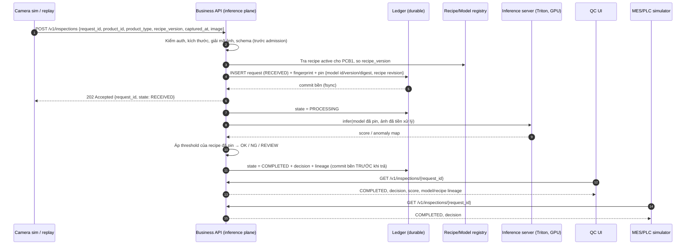
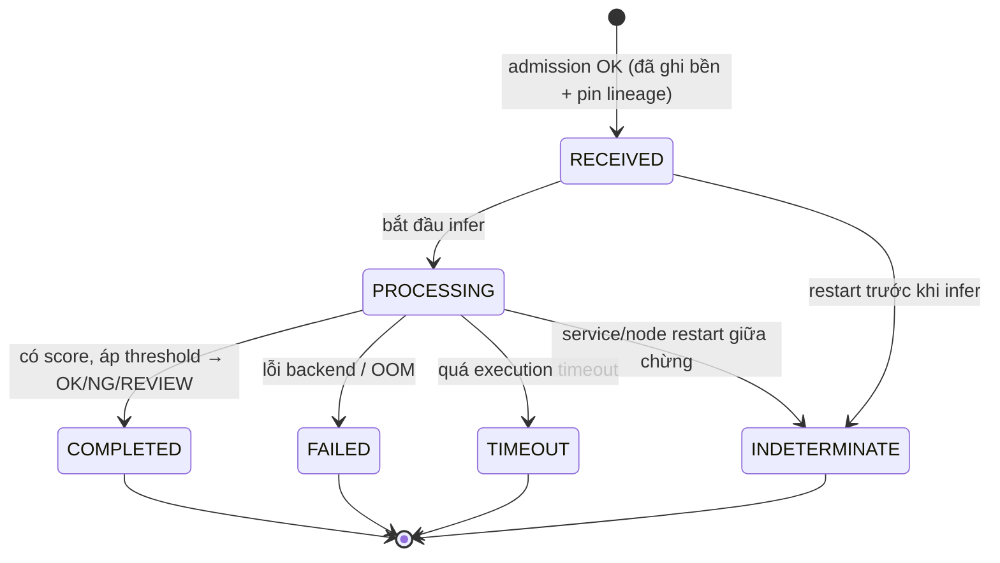

# W2-01 — Use-case specification: PCB1 visual anomaly (MVP một trạm)

Phiên bản: **draft-1, 06/10/2026**. Trạng thái: **ĐÃ NỘP — CHỜ QC/INTEGRATION XÁC NHẬN**. Đây chưa phải tài liệu đã được chấp nhận.

Nguồn quyết định: phản hồi của mentor cho các câu 7, 8, 9, 10 (sheet `Phản hồi câu hỏi`, workbook reviewed 30/09). Những điểm mentor **chưa** trả lời được đánh dấu **[ĐỀ XUẤT]** và cần mentor/QC chốt.

Bản máy đọc được của các bảng trong tài liệu này: `usecase-pcb1.json`. Lệnh kiểm `check_w2_01.py` dùng file đó để kiểm tính nhất quán và chạy probe lên controller lab.

---

## 1. Phạm vi

| | Trong MVP | Ngoài MVP |
|---|---|---|
| Sản phẩm | PCB1 (dataset VisA, CC BY 4.0, cần ghi attribution) | Sản phẩm/loại lỗi khác |
| Trạm | 1 edge giả lập, 1 Linux server + 1 GPU NVIDIA | Nhiều trạm, HA nhiều node |
| Nguồn ảnh | Dataset replay / camera simulator | Camera công nghiệp thật |
| Model | Model anomaly **hoặc** deterministic stub, đóng gói theo ModelPackage W2-05 | Model QC do nhà máy huấn luyện (chờ QC cấp) |
| Consumer | QC UI + MES/PLC **simulator** | PLC/robot thật, safety logic |
| Dữ liệu | Ảnh public có license rõ, synthetic data | Dữ liệu production (chưa được duyệt) |
| Mạng | Không có Internet trên target air gap | Kết nối cloud |

Nghiệm thu ở tài liệu này là **platform/integration gate**. **Quality gate** (accuracy, threshold OK/NG/REVIEW) cần acceptance set và metric do QC duyệt (câu 7) và không được suy ra từ dữ liệu public hay model mẫu.

## 2. Actor và thông tin của một lượt kiểm tra

| Thành phần | Định nghĩa |
|---|---|
| **Actor chính** | *Image Source*: camera simulator hoặc dataset replay tool, chạy với tài khoản kỹ thuật `operator`/service, quyền chỉ gửi ảnh |
| **Trigger** | Một sản phẩm tới vị trí chụp. Trong MVP, replay tool phát một sự kiện "product-in-position" kèm ảnh. Trên dây chuyền thật, trigger do PLC/MES phát (ngoài MVP) |
| **Một lượt** | **Một ảnh / một request / batch 1** |
| `request_id` | Do bên gửi tạo, duy nhất cho mỗi **lần kiểm tra**, 1–128 ký tự. Đây là khóa idempotency: gửi lại cùng ID là "hỏi lại", không phải "kiểm lại" |
| `product_id` | Mã của từng sản phẩm (serial) đang được kiểm |
| `product_type` | `PCB1`. Dùng để tra recipe |
| `recipe_version` | Phiên bản recipe bên gửi đang mong đợi. Hệ thống đối chiếu với recipe đang active |
| `captured_at` | Thời điểm chụp, ISO-8601 UTC |
| `station_id` | Mã trạm (MVP: một giá trị) |
| `image` | JPEG/PNG, tối đa 4 MiB, giải mã được, đúng kích thước/kênh màu theo recipe |
| **Kết quả** | `state` (trạng thái xử lý) + `decision` (OK/NG/REVIEW, **chỉ có khi** `state=COMPLETED`) + `score`, threshold, model id/version/digest, recipe revision, thời gian từng pha |
| **Consumer** | QC UI (người xem kết quả, xử lý REVIEW) và MES/PLC simulator (đọc kết quả theo `request_id`) |

## 3. Nguyên tắc cốt lõi: kết quả chất lượng ≠ lỗi kỹ thuật

| Loại | Giá trị | Ý nghĩa | Ai quyết định |
|---|---|---|---|
| **Kết luận chất lượng** | `OK`, `NG`, `REVIEW` | Nhận định về **sản phẩm**. `REVIEW` = điểm nằm trong vùng không chắc chắn, cần người xem | Model + threshold trong recipe do QC duyệt |
| **Trạng thái kỹ thuật** | `REJECTED` (không admission), `FAILED`, `TIMEOUT`, `INDETERMINATE` | **Hệ thống** không đưa ra được kết luận | Platform |

Các quy tắc bắt buộc:

1. Lỗi kỹ thuật **không bao giờ** được ghi thành `NG` hay `OK`. Khi không có kết luận, `decision = null`.
2. Một kết quả chỉ được trả cho đúng `request_id`/`product_id` đã gửi. Hệ thống không chấm bằng model/recipe khác với bản đã pin lúc nhận (**không trả nhầm kết quả cho sản phẩm**).
3. Sản phẩm có trạng thái kỹ thuật thì **không được coi là đã kiểm**. Dây chuyền xử lý nó thế nào (giữ lại, kiểm tay, chụp lại) là quyết định của QC/Operations. **[ĐỀ XUẤT]** MVP hiển thị các sản phẩm này trên QC UI như REVIEW-kỹ-thuật, tách riêng khỏi REVIEW-chất-lượng.
4. Hệ thống tự phục hồi **không** đồng nghĩa với việc tự cho dây chuyền chạy tiếp.

## 4. Happy path

Ghi chú:

- **[ĐỀ XUẤT]** Submit trả `202` ngay sau khi admission đã được ghi bền, consumer đọc kết quả bằng GET. Lý do: inference khoảng 1–2 s; khi mất kết nối, kết quả vẫn còn để đọc lại (câu 10). Lab controller hiện tại trả kết quả đồng bộ trong cùng HTTP call, khác điểm này. API chi tiết thuộc W2-04.
- **Pin lineage** diễn ra một lần duy nhất lúc admission. Đổi model/recipe sau thời điểm đó chỉ ảnh hưởng request **mới** (khớp cơ chế cutover của Item 3).
- **Tiêu chí thành công của một lượt:** tồn tại đúng một record cho `request_id`, ở state terminal, `decision` khác null chỉ khi `COMPLETED`, lineage đủ (model + recipe + thời gian từng pha) và consumer đọc lại được.

## 5. Bảng normal / failure

Nhãn **Lab** cho biết controller lab `server-runner-v2/controller.py` (snapshot trong gói evidence) **đã có hành vi này hay chưa**:

- ✅ = có code và có test/probe PASS.
- ⚠️ = có code, chưa có test riêng.
- ❌ = chưa có (GAP), cần làm ở W3.

| ID | Tình huống | Hành vi yêu cầu | Mã / state | Record trong ledger | Consumer thấy | Lab |
|---|---|---|---|---|---|---|
| N1 | Ảnh hợp lệ, model sẵn sàng | Pin → infer → threshold → lưu | 202 → `COMPLETED` + OK/NG/REVIEW | Có, đủ lineage | Kết quả theo ID | ⚠️ COMPLETED có; **OK/NG/REVIEW chưa** (model ImageNet) |
| F1 | Body/base64 sai, thiếu trường bắt buộc | Từ chối **trước admission** | `400` | Không tạo | Lỗi + lý do | ✅ |
| F2 | Ảnh vượt 4 MiB | Từ chối trước admission | `413` | Không tạo | Lỗi | ✅ (probe) |
| F3 | Base64 hợp lệ nhưng không giải mã được ảnh / sai kích thước/kênh màu | Từ chối trước admission | `422` | Không tạo | Lỗi + lý do | ❌ lab nhận và chạy infer |
| F4 | Gửi lại **cùng ID, cùng payload** (retry) | Trả record cũ, **không** infer lại | `200` (đã xong) / `202` (đang xử lý) | Giữ nguyên 1 record | Kết quả cũ | ✅ |
| F5 | **Cùng ID, payload khác** | Từ chối | `409` | Giữ record cũ | Lỗi xung đột | ✅ |
| F6 | `product_type` không có recipe / `recipe_version` không khớp recipe active | Từ chối, **không** chấm bằng recipe khác | `422` (không có recipe) / `409` (sai version) **[ĐỀ XUẤT mã]** | Không tạo | Lỗi + recipe đang active | ❌ |
| F7 | Hàng đợi đầy (admission giới hạn) | Từ chối, khuyến khích retry **cùng ID** | `429` | Không tạo | Lỗi tạm thời | ✅ |
| F8 | Model chưa ready / đang khởi động / GPU mất | Dừng nhận request mới; readiness báo not ready | `503` | Không tạo | Lỗi tạm thời | ⚠️ readiness 503 có; submit chưa chặn theo readiness |
| F9 | Storage/ledger lỗi (đĩa đầy, I/O error) | Dừng nhận mới; **không** trả kết quả chưa được lưu bền | `503` | Không tạo / không đổi | Lỗi tạm thời | ❌ |
| F10 | Lỗi inference sau admission (crash backend, CUDA OOM) | Ghi terminal, không đổi model âm thầm; rollback chỉ theo cơ chế cutover đã test | `FAILED`, `decision=null` | Có, lineage giữ nguyên | FAILED theo ID | ✅ |
| F11 | Inference quá thời gian thực thi | Ghi `TIMEOUT`; kết quả về muộn chỉ được log, **không** đổi terminal state | `TIMEOUT`, `decision=null` | Có | TIMEOUT theo ID | ❌ (chưa có execution timeout riêng) |
| F12 | Service/node **restart** khi request đang `PROCESSING` | Khi khởi động lại, chuyển thành `INDETERMINATE`, **không** tự chạy lại | `INDETERMINATE`, `decision=null` | Có, lineage giữ nguyên | INDETERMINATE theo ID | ✅ |
| F13 | Restart sau khi đã chuyển model active (A→B) | Phục hồi **đúng** model/recipe active đã lưu bền. Nếu không xác minh được thì `503` cho tới khi admin xác nhận | Active giữ nguyên | — | — | ❌ lab về A sau restart (cùng phát hiện Item 11 ngày 05/10) |
| F14 | Consumer mất kết nối trước khi nhận kết quả | Kết quả vẫn được lưu; consumer đọc lại theo ID | `200` khi GET | Có | Đọc lại được | ✅ |
| F15 | Hỏi ID không tồn tại | Báo không có | `404` | — | — | ✅ |
| F16 | Request đang chạy thì có lệnh chuyển model | Request giữ model đã pin; model mới chỉ cho request sau | Lineage không đổi | Có | Đúng model đã pin | ✅ (test cutover/drain) |

Cách retry sau trạng thái kỹ thuật **[ĐỀ XUẤT]**: `FAILED`/`TIMEOUT`/`INDETERMINATE` là terminal cho `request_id` đó. Muốn kiểm lại phải tạo `request_id` **mới** cho cùng `product_id`, kèm `retry_of = <id cũ>`, để lịch sử ghi đủ hai lần thử. Gửi lại ID cũ chỉ trả về record cũ (F4).

## 6. Bảng trạng thái

| Từ | Sang | Điều kiện | Có `decision`? |
|---|---|---|---|
| — | `RECEIVED` | Qua mọi kiểm tra trước admission, ghi bền thành công | Không |
| `RECEIVED` | `PROCESSING` | Worker lấy request, model đã pin đang loaded | Không |
| `PROCESSING` | `COMPLETED` | Inference trả score, áp threshold của recipe đã pin, ghi bền | **Có** (OK/NG/REVIEW) |
| `PROCESSING` | `FAILED` | Exception backend/GPU/OOM | Không |
| `PROCESSING` | `TIMEOUT` | Vượt execution timeout | Không |
| `RECEIVED`/`PROCESSING` | `INDETERMINATE` | Phát hiện lúc khởi động lại sau restart/crash | Không |

Các state terminal (`COMPLETED`, `FAILED`, `TIMEOUT`, `INDETERMINATE`) **không bao giờ chuyển tiếp**. Từ chối trước admission (`400/409/413/422/429/503`) không tạo state nào. Ghi chú: lab controller gộp `RECEIVED` vào `PROCESSING` (ghi `PROCESSING` ngay lúc admission); đây là khác biệt chấp nhận được trong lab và sẽ được tách ở W3.

## 7. Tiêu chí hoàn tất (platform gate) và câu hỏi chờ xác nhận

Tiêu chí đề xuất cho W3/W4. Mỗi dòng F1–F16 phải có test tự động:

1. **0** kết quả gắn sai `request_id`/`product_id`/model/recipe so với lineage đã pin.
2. **0** trường hợp lỗi kỹ thuật mang `decision` OK/NG.
3. Mọi request đã admission đều kết thúc ở đúng một state terminal, kể cả sau restart.
4. Mọi tình huống F1–F16 có test PASS; GAP hiện tại (F3, F6, F9, F11, F13, OK/NG/REVIEW) phải được đóng.

Câu hỏi cần QC/integration chốt (trạng thái câu 7, 9 là "tạm chốt"):

| # | Câu hỏi | Đầu mối |
|---|---|---|
| Q1 | Threshold OK/NG và vùng REVIEW, acceptance set đã gán nhãn, metric | QC Owner |
| Q2 | Sản phẩm ở trạng thái kỹ thuật (FAILED/TIMEOUT/INDETERMINATE) được xử lý thế nào trên dây chuyền | QC + Operations |
| Q3 | Execution timeout mỗi request (đề xuất 10 s khi inference khoảng 1–2 s) | Operations |
| Q4 | Định dạng `product_id`; MES simulator đọc kết quả theo pull (GET) hay push | Integration |
| Q5 | Retry bằng `request_id` mới + `retry_of` có phù hợp với truy vết của nhà máy không | QC + Integration |
| Q6 | Mã lỗi cho sai recipe (409/422) | Mentor (chốt cùng W2-04) |

## 8. Liên kết sang task khác

- **W2-03:** mục 6 là đầu vào bảng state-transition chi tiết (retry, sai thứ tự, recovery).
- **W2-04:** F1–F16 là danh sách contract/error example cho OpenAPI.
- **W2-05:** pin model/recipe dùng ModelPackage/Recipe (digest, revision).
- **Item 3:** F16 khớp cơ chế cutover đã test (pin lúc admission, drain trước unload).
- **Item 11:** F13 là phát hiện ngày 05/10 trên A6000 (model active không giữ qua reboot).
