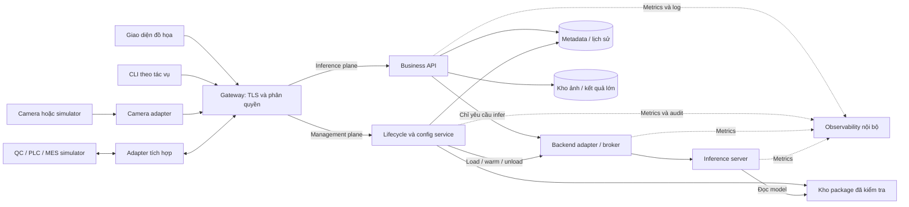
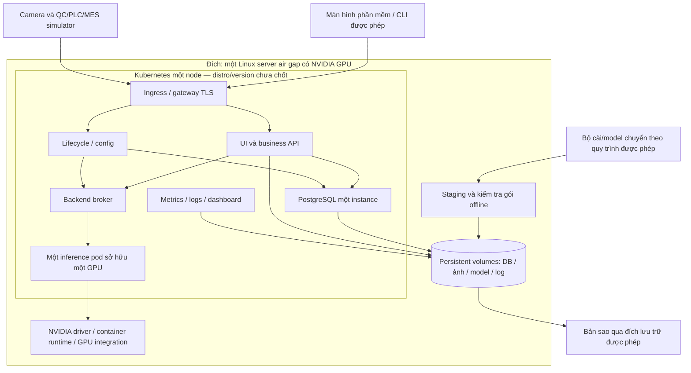
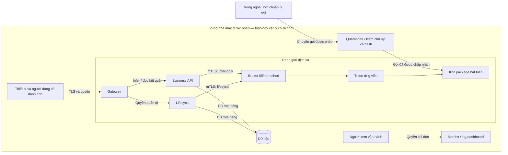

# W2-02 — Kiến trúc platform AI trên một máy chủ

> **Cập nhật 06/10/2026 (item 14):** tài liệu này (draft-1, 29/09) là **target architecture**. Phạm vi MVP, danh sách thành phần hoãn, ADR storage, network matrix và failure/sizing/backup nằm ở [W2-02-MVP-VA-TARGET.md](W2-02-MVP-VA-TARGET.md). Các chỗ ghi **PostgreSQL** dưới đây thuộc target; MVP dùng SQLite theo [ADR D09](ADR-D09-STORAGE-SQLITE-MVP.md).

## Giải thích cho nhân sự vận hành ở nhà máy

Một máy chủ Linux giữ toàn bộ phần mềm và dữ liệu cần để kiểm tra bằng AI. Camera hoặc bộ giả lập gửi ảnh, platform gắn ảnh với mã sản phẩm, chọn đúng model/cấu hình, xử lý và lưu kết quả. Nhân viên vận hành theo dõi trạng thái và lịch sử qua giao diện phần mềm, chuyên viên kỹ thuật có thể dùng CLI để chẩn đoán hoặc thực hiện tác vụ quản trị. Cả hai đều đi qua cùng cơ chế xác thực và phân quyền.

Máy chủ được thiết kế hoạt động không cần Internet. Bộ cài, model, giao diện, tài liệu và công cụ theo dõi phải có sẵn.

## 1. Component diagram — mỗi bộ phận làm gì

Đường nét liền là dữ liệu hoặc điều khiển, nét đứt là theo dõi. Package mới đi vào vùng staging/quarantine, được kiểm tra trước khi xuất hiện trong kho đã duyệt.

| Thành phần           | Trách nhiệm                                                                                           | Protocol / dependency đề xuất                                                                                                              |
| ---------------------- | ------------------------------------------------------------------------------------------------------- | --------------------------------------------------------------------------------------------------------------------------------------------- |
| UI                     | Trạng thái, ảnh test, kết quả/lịch sử, thao tác được cấp quyền                             | HTTPS/JSON tới gateway, static assets có sẵn offline, không CDN.                                                                          |
| CLI                    | Analysis/debug và thao tác theo vai trò, có kết quả/mã lỗi rõ                                  | Cùng HTTPS API và quyền với UI, không yêu cầu user thường có shell/root/kubeconfig.                                                 |
| Gateway                | Xác thực thiết bị/người dùng, giới hạn request, định tuyến, từ chối quyền sai            | TLS ngoài, TLS/mTLS tới service. Dùng CA/danh tính nội bộ, không phụ thuộc đăng nhập cloud.                                       |
| Business API           | Nhận ảnh/product ID, lưu request, gắn phiên bản recipe/package, trả trạng thái/kết quả       | HTTPS/JSON, PostgreSQL qua TLS, kho ảnh cục bộ, broker qua mTLS. Chi tiết API/state machine để W2-03/04 chốt.                          |
| Lifecycle/config       | Đăng ký package, quản lý revision, activate/rollback, audit                                        | HTTPS/JSON, DB, package store, broker. Một thao tác thay active recipe tại một thời điểm cho một station.                             |
| Backend adapter/broker | Tiền/hậu xử lý được cho phép, chuyển yêu cầu sang tensor, phân quyền infer và load/unload | mTLS từ API/lifecycle, gRPC/TLS tới Triton ứng viên. Allowlist method theo service identity, không proxy tùy ý.                        |
| Inference server       | Thực thi model trên GPU, cung cấp metadata/load state                                                | Triton là ứng viên tái sử dụng lab, chọn runtime/version chính thức sau review. Chỉ broker được gọi cổng dữ liệu/quản trị. |
| Metadata store         | Request ID, product ID giả, trạng thái, digest model/recipe/config, audit/activation                 | PostgreSQL một instance trên persistent volume, TLS và DB roles riêng. Đây là lựa chọn đề xuất, chưa deploy.                     |
| File store             | Ảnh, output lớn, model bất biến, tách staging khỏi kho được duyệt                             | Local persistent volume, đường dẫn nội bộ, không cho client truyền path tùy ý. Model mount read-only cho serving.                   |
| Observability          | Health, độ trễ, tài nguyên GPU/CPU, dung lượng, cảnh báo và audit                             | Prometheus-format qua HTTPS có quyền, log collector nội bộ, dashboard nội bộ. Không export ra Internet.                                |

Mọi adapter chuyển dữ liệu cần contract, không để UI hoặc MES phụ thuộc API riêng của Triton.

## 2. Deployment diagram — chạy ở đâu

- UI tĩnh, binaries tự phát triển, image hạ tầng, driver/packages, CA/trust store và model phải được đưa vào gói offline. Image pin bằng digest, không tự ý update.
- OS, driver, CUDA/backend và distro K8s phải nằm trong ma trận tương thích đã kiểm thử.
- Một GPU được cấp cho một inference pod. Model A và B có thể cùng được load trong pod này nếu đủ VRAM.
- Nếu không đủ VRAM A+B, từ chối hot switch và giữ model đang hoạt động, phương án maintenance cần review riêng.
- Persistent volume không mất cùng pod. Snapshot/backup trên cùng ổ không bảo vệ khỏi hỏng ổ, nơi backup ngoài máy và quy trình restore offline cần IT/OT chốt.

## 3. Trust-boundary diagram — ai được đi qua đâu

- Chữ ký chứng minh nguồn gói theo trust store, checksum phát hiện thay đổi byte.
- Audit ghi người/thiết bị, thao tác, thời gian, phiên bản trước/sau và kết quả.

## 4. Ba đường hoạt động cần review

**Inference:** ảnh/product ID → gateway → business API → ghi request và pin package digest + recipe/config revision → broker xử lý ảnh và infer → score → áp ngưỡng recipe → lưu kết quả/truy vết → client/adapter đọc kết quả.

**Management:** người có quyền admin → gateway → lifecycle → kiểm schema/hash/chữ ký/tương thích/tài nguyên → load candidate → warm-up + golden → commit active revision → cho request mới dùng bản mới, drain request cũ → unload khi an toàn

**Metrics:** các service/GPU exporter → collector nội bộ → dashboard/cảnh báo. Theo dõi readiness, lỗi, thời gian từng bước, queue, RAM/VRAM, dung lượng và kết quả activation. Khi observability lỗi, không được làm một request lỗi cần request lại hoặc review.

## 5. Tiêu chí review của bản thiết kế

Reviewer lần theo được cả ba đường, mỗi module có trách nhiệm/protocol/dependency, UI/CLI bị kiểm quyền như nhau, thiết bị giả lập có vị trí thay thế rõ, không có đường điều khiển safety, giải thích được giới hạn một máy/một GPU, nhận diện được những phần phải chỉnh sau W2-01/03. Phép đo performance, xác nhận policy nhà máy và nghiệm thu triển khai là các bước sau.
