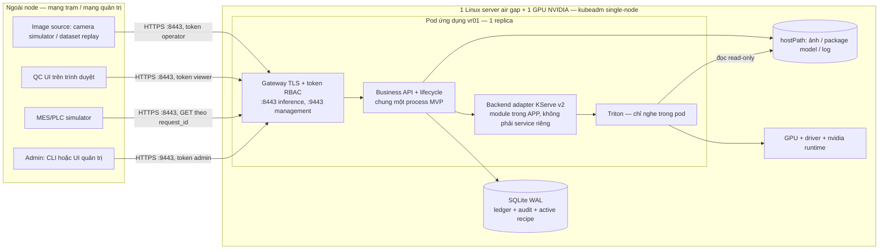
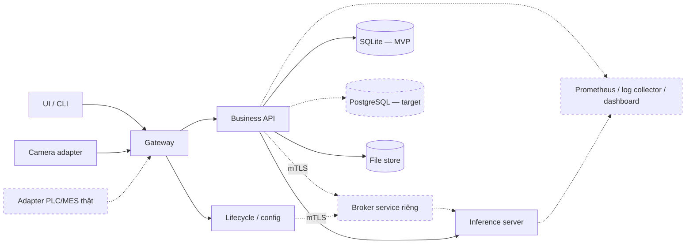

# W2-02 — Tách kiến trúc MVP và target (sửa theo item 14)

Phiên bản: **draft-2, 06/10/2026**. Trạng thái: **SOẠN LẠI THEO REVIEW 30/09 — CHỜ MENTOR XÁC NHẬN**. Đây chưa phải tài liệu đã được chấp nhận.

Tài liệu này bổ sung cho [W2-02-KIEN-TRUC.md](W2-02-KIEN-TRUC.md) (draft-1, 29/09). Bản draft-1 vẽ **target architecture**. Tài liệu này vẽ thêm **MVP architecture** và ghi rõ phần nào bị hoãn, vì sao.

Bộ tài liệu item 14:

| Tài liệu | Trả lời phần nào của mentor |
|---|---|
| File này | Hai sơ đồ scope; danh sách thành phần hoãn khỏi MVP |
| [ADR-D09-STORAGE-SQLITE-MVP.md](ADR-D09-STORAGE-SQLITE-MVP.md) | SQLite hay PostgreSQL; đường migration |
| [W2-02-NETWORK-MATRIX.md](W2-02-NETWORK-MATRIX.md) | Port/protocol/trust flow |
| [W2-02-FAILURE-SIZING-BACKUP.md](W2-02-FAILURE-SIZING-BACKUP.md) | Failure domain một node, sizing, retention, nơi backup |
| [DECISIONS W2-02-assumptions.md](DECISIONS%20W2-02-assumptions.md) | Decision index D01–D13 (đã thêm D09, D13), trace về W2-01 |

Phạm vi MVP lấy theo [W2-01 §1](W2-01/W2-01-USE-CASE-PCB1.md): **1 trạm giả lập, 1 Linux server + 1 GPU NVIDIA, PCB1, 1 ảnh/request, QC UI + MES/PLC simulator**.

---

## 1. MVP architecture — chỉ những gì phải chạy cho một trạm

Ghi chú cho người mới đọc:

- **Một pod, một node.** Mọi thành phần MVP nằm trong một pod ứng dụng trên một máy. Lab hiện tại (manifest `docs/Tuan_1c/release_r4.6/update-w105-v2.yaml`) đã chạy đúng dạng này: container `triton-controller` + container `https-gateway`, 1 replica, chiến lược `Recreate`.
- **Business API và lifecycle chung một process.** Hai *plane* (cổng 8443 cho inference, 9443 cho quản trị) vẫn tách theo cổng và quyền như [W2-04](W2-04/W2-04-API-CONTRACT.md); chỉ là không tách thành hai deployment.
- **Adapter là module, không phải service.** Ranh giới "chỉ adapter biết Triton" vẫn giữ trong code (`KServeV2Backend`), nhưng không cần mTLS giữa hai service riêng.
- **Triton không có đường vào từ ngoài pod.** NetworkPolicy lab chỉ cho ingress TCP 8443 và egress rỗng.
- **Metrics/log MVP** = endpoint health/readiness + file log có xoay vòng + script kiểm tra. Không có Prometheus/Grafana.

Ba đường hoạt động trong MVP:

| Đường | Đi qua | Ghi bền ở đâu |
|---|---|---|
| Inference | Image source → :8443 → API → pin recipe/package vào ledger → adapter → Triton → threshold → ledger | SQLite (request, state, lineage), file store (ảnh nếu bật lưu) |
| Management | Admin → :9443 → lifecycle → validate/warm/golden → đổi active revision → drain → unload | SQLite (active revision, audit) |
| Theo dõi | Admin/viewer → health/readiness, log file, script kiểm | Log file trên hostPath, có giới hạn dung lượng |

## 2. Target architecture — giữ nguyên bản draft-1

Sơ đồ component/deployment/trust-boundary của [W2-02-KIEN-TRUC.md](W2-02-KIEN-TRUC.md) mục 1–3 là **target**: broker tách riêng với mTLS, PostgreSQL, observability stack, adapter tích hợp thật. Sơ đồ dưới chỉ đánh dấu phần nào **đã có trong MVP** (nét liền) và phần nào **hoãn** (nét đứt).

## 3. Thành phần hoãn khỏi MVP và vì sao

| Thành phần target | MVP dùng gì thay | Vì sao hoãn | Điều kiện đưa trở lại |
|---|---|---|---|
| **PostgreSQL** | SQLite WAL, một writer | 1 trạm, 1 process ghi; SQLite đã có evidence lab (xem ADR D09) | Trigger trong [ADR D09](ADR-D09-STORAGE-SQLITE-MVP.md) |
| **Broker service riêng + mTLS nội bộ** | Adapter là module trong API; Triton chỉ nghe trong pod, NetworkPolicy chặn | Trong một pod, traffic API→Triton không ra khỏi network namespace của pod. Tách service thì phải cấp và gia hạn thêm chứng chỉ nội bộ **offline**, tăng việc vận hành nhưng không giảm rủi ro đáng kể ở một node | Có nhiều client gọi inference trực tiếp, hoặc tách pod GPU khỏi pod API |
| **Prometheus / log collector / dashboard** | Health/readiness, log file xoay vòng, script kiểm | Thêm image vào gói air gap (dung lượng, CVE, version phải pin) và thêm RAM/đĩa trên máy duy nhất. MVP cần **biết hỏng**, chưa cần biểu đồ xu hướng | Operations yêu cầu cảnh báo/biểu đồ; W4 có SLA cần đo liên tục |
| **Adapter PLC/MES thật** | MES/PLC **simulator** đọc kết quả qua API | Mentor không cho nối PLC/robot thật, không đụng safety logic (W2-01 §1) | Integration duyệt protocol và có môi trường test |
| **Camera adapter thật** | Dataset replay / camera simulator | Chưa có camera, chưa chốt SDK | QC/Integration cấp camera và format |
| **Ingress controller riêng** | Gateway trong pod đứng làm TLS endpoint | Một entry point, ít thành phần hơn trong gói offline | Nhiều app/host name cùng node |
| **HA, nhiều node, nhiều GPU** | Không có | Mentor chốt kubeadm single-node (30/09) | Ngoài phạm vi 5 tuần |
| **PKI nhà máy cấp chứng chỉ** | Chứng chỉ/khóa lab tự tạo, token lab | Chờ Security/PKI (context mục 2, câu 6) | PKI/IT cấp CA và quy trình gia hạn/thu hồi |

**Không hoãn** (bắt buộc có trong MVP, vì W2-01 cần): TLS + token/RBAC (viewer/operator/admin), ledger bền với pin model/recipe lúc admission, idempotency theo `request_id`, activate/rollback có audit, giữ active revision qua restart (F13), giới hạn dung lượng log/ảnh.

## 4. Còn mở, cần mentor/IT chốt

1. **Cách đưa cổng 8443/9443 ra mạng trạm.** Lab hiện truy cập qua `kubectl port-forward` tới `127.0.0.1:18443` (runner item 11), **chưa** có NodePort/hostPort/LoadBalancer. Đề xuất cho MVP: `hostPort` hoặc `NodePort` cố định trên một IP của mạng trạm, kèm firewall host. Chi tiết trong [network matrix](W2-02-NETWORK-MATRIX.md) mục 3.
2. **Cổng 9443 chưa có trong manifest lab.** Manifest w105 chỉ có gateway 8443. Reference API W2-04 có tách 8443/9443 nhưng chưa được deploy lên Kubernetes.
3. Thông số sizing/retention là giả định, xem [W2-02-FAILURE-SIZING-BACKUP.md](W2-02-FAILURE-SIZING-BACKUP.md).
