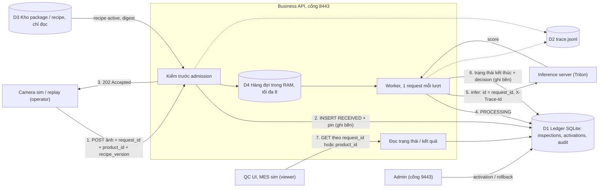
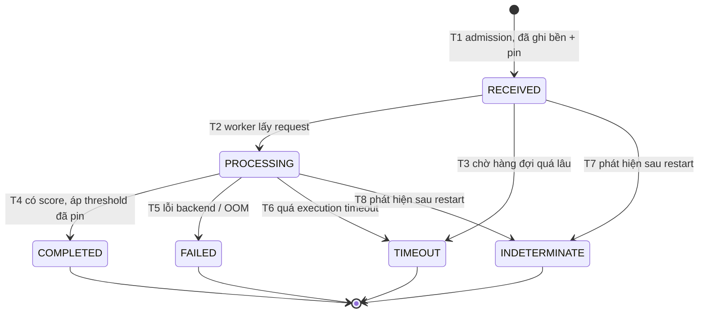

# W2-03 — Data flow và inspection state machine (PCB1, MVP một trạm)

Phiên bản: **draft-1, 10/10/2026**. Trạng thái: **BẢN NHÁP, CHƯA GỬI MENTOR**. Hạn gốc của task là 02/10; bản này nộp trễ.

Nguồn quyết định: phản hồi mentor câu 10 (xử lý lỗi), W2-01 draft-1 (mục 5–6), W2-04 draft-1 (hợp đồng API). Điểm nào mentor chưa trả lời được đánh dấu **[ĐỀ XUẤT]**.

Bản máy đọc được: `state-machine.json`. Lệnh kiểm: `check_w2_03.py` (mục 9). Mọi hành vi ghi "đã quan sát" trong tài liệu này là do lệnh kiểm chạy trên **server tham chiếu W2-04** (`../W2-04/reference_api.py`), không phải trên gateway/controller đang chạy trên Kubernetes.

---

## 1. Tóm tắt

- Mỗi lượt kiểm tra là **một dòng trong ledger**, khóa bằng `request_id`. Dòng đó đi qua `RECEIVED → PROCESSING → ` một trong bốn trạng thái kết thúc: `COMPLETED`, `FAILED`, `TIMEOUT`, `INDETERMINATE`. Trạng thái kết thúc **không bao giờ đổi nữa**.
- Lúc nhận request (admission), hệ thống ghi bền **một lần duy nhất**: sản phẩm nào, ảnh nào (SHA-256), recipe/model nào. Kết quả về sau chỉ được gắn vào đúng dòng đó. Đây là cách chống trả nhầm kết quả cho sản phẩm khác.
- Hệ thống **không tự chạy lại** inference. Sau sự cố, request dở dang thành `INDETERMINATE`; muốn kiểm lại thì bên gửi tạo `request_id` mới kèm `retry_of`.
- Đã quan sát đủ 8 chuyển trạng thái và 8 bất biến trên server tham chiếu, gồm một ca **kill -9 tiến trình** khi 1 request đang infer và 2 request đang chờ.
- Còn 5 điểm thiếu (G1–G5) phải đóng ở W3. Retention là đề xuất, chờ QC/IT.

## 2. Data flow



**Kho dữ liệu**

| Kho | Chứa gì | Vai trò |
|---|---|---|
| D1 Ledger (SQLite, WAL, `synchronous=FULL`) | `inspections`, `activations`, `audit` | **Nguồn sự thật duy nhất** về trạng thái request và recipe đang active |
| D2 `trace.jsonl` | Sự kiện theo `trace_id`: admitted, started, finished, terminal, late result | Debug và truy vết chi tiết. Không dùng để quyết định trạng thái |
| D3 Kho package/recipe | File bất biến kèm digest (W2-05) | Chỉ đọc. Digest được kiểm lại mỗi lần khởi động |
| D4 Hàng đợi trong RAM | Request đã admission, chưa tới lượt | **Mất khi restart.** Vì vậy request đang chờ phải được tìm lại từ D1 (chuyển T7) |
| Kho ảnh gốc | — | **Chưa có** (G5). Hiện chỉ lưu `input_sha256` |

**Định danh đi xuyên suốt**

| Định danh | Ai tạo, lúc nào | Lưu ở đâu | Dùng để làm gì |
|---|---|---|---|
| `request_id` | Bên gửi, mỗi lần kiểm tra | Ledger (`UNIQUE`), trace, gửi sang inference server làm `id`, mọi response | Khóa idempotency và khóa đọc kết quả |
| `product_id` | Bên gửi | Ledger (có index), `result.lineage`, trace | Tra mọi lần kiểm của một sản phẩm |
| `trace_id` | Client gửi `X-Trace-Id`, nếu không thì server tạo | Ledger, trace, header sang inference server, header response | Nối log của một request qua các thành phần |
| `input_sha256` | Server tính lúc admission | Ledger, `result.lineage` | Chứng minh kết quả thuộc đúng ảnh đã gửi |
| `fingerprint` | Server, từ các trường nghiệp vụ + `input_sha256` | Ledger | Phân biệt "gửi lại" (replay) với "ID bị dùng cho payload khác" (409) |
| Pin: recipe (tên, version, SHA-256), model (tên, version, manifest SHA-256), threshold, review band | Server, **một lần** lúc admission | Ledger `pin_json`, `result.lineage` | Không bao giờ chấm bằng recipe/model khác |
| `retry_of` | Bên gửi, khi kiểm lại | Ledger, status | Nối các lần thử của cùng sản phẩm |
| `seq` | Ledger tự tăng | Ledger | Thứ tự admission |
| `captured_at` | Bên gửi | Chỉ nằm trong `fingerprint` (G3) | Thời điểm chụp |

## 3. State machine



| ID | Từ | Sang | Sự kiện | Ghi bền gì | `reason` | Có `decision`? |
|---|---|---|---|---|---|---|
| T1 | — | `RECEIVED` | Submit qua hết mọi kiểm tra trước admission | INSERT: `request_id`, `fingerprint`, `product_id`, `input_sha256`, `trace_id`, pin | — | Không |
| T2 | `RECEIVED` | `PROCESSING` | Worker lấy request trong `queue_timeout_s` | `started_at`, `queue_ms` | — | Không |
| T3 | `RECEIVED` | `TIMEOUT` | Chờ hàng đợi lâu hơn `queue_timeout_s`; không gọi backend | `finished_at` | `QUEUE_TIMEOUT` | Không |
| T4 | `PROCESSING` | `COMPLETED` | Backend trả score; áp threshold của recipe **đã pin** | `decision`, `score`, `finished_at`, ghi xong mới cho đọc | — | **Có** (OK/NG/REVIEW) |
| T5 | `PROCESSING` | `FAILED` | Backend lỗi, GPU OOM | `finished_at` | `BACKEND_ERROR` | Không |
| T6 | `PROCESSING` | `TIMEOUT` | Inference lâu hơn `execution_timeout_s` | `finished_at` | `EXECUTION_TIMEOUT` | Không |
| T7 | `RECEIVED` | `INDETERMINATE` | Lúc khởi động lại, thấy request còn đang chờ | `finished_at`, trước khi mở cổng | `RESTARTED_DURING_PROCESSING` | Không |
| T8 | `PROCESSING` | `INDETERMINATE` | Lúc khởi động lại, thấy request đã bắt đầu infer | `finished_at`, trước khi mở cổng | `RESTARTED_DURING_PROCESSING` | Không |

Ngoài 8 dòng trên **không có chuyển trạng thái nào khác**. Ba hệ quả:

1. Bốn trạng thái kết thúc không có lối ra.
2. Hai trạng thái chưa kết thúc đều có lối thoát khi crash (T7, T8), nên không request nào kẹt mãi.
3. `decision` chỉ xuất hiện ở T4.

**Từ chối trước admission không tạo trạng thái nào.** Các mã 400, 401, 403, 408, 413, 415, 422, 409 `RECIPE_VERSION_MISMATCH`, 429, 503 đều không tạo dòng trong ledger (bảng đầy đủ ở W2-04 mục 7). Riêng 409 `IDEMPOTENCY_CONFLICT` thì dòng cũ giữ nguyên.

**Thứ tự kiểm lúc submit** (theo code server tham chiếu): schema → base64 → kích thước → giải mã ảnh → **idempotency** → readiness → sản phẩm/trạm → `retry_of` → recipe version → hàng đợi → INSERT. Idempotency được kiểm **trước** readiness và recipe, nên bên gửi vẫn hỏi lại được kết quả cũ khi server đang not-ready hoặc recipe đã đổi.

So với W2-01 mục 6, bản này thêm **T3** (`RECEIVED → TIMEOUT`). W2-04 đã có hành vi này (queue timeout tách khỏi execution timeout), nhưng bảng trạng thái W2-01 chưa ghi. Bảng ở đây thay cho bảng W2-01 mục 6; W2-01 sẽ được sửa ở draft kế tiếp.

## 4. Retry, idempotency, duplicate

| Tình huống | Bên gửi làm gì | Hệ thống làm gì |
|---|---|---|
| Không nhận được response (rớt mạng, client timeout) | Gửi lại **cùng** `request_id`, cùng payload | Chưa admission: xử lý bình thường, 202. Đã admission: `200` + `Idempotent-Replay: true`, trả dòng cũ, **không infer lại** |
| `429`, `503`, `408` | Chờ `Retry-After`, gửi lại cùng `request_id` | Như trên |
| `409 RECIPE_VERSION_MISMATCH` | Lấy lại active-recipe rồi gửi lại. Dùng lại được ID cũ vì chưa có dòng nào được tạo | Xử lý như request mới |
| `400`, `413`, `422` | Sửa request. Không retry tự động | Không tạo dòng |
| Cùng `request_id`, payload khác | Lỗi tích hợp, phải sửa phía gửi | `409 IDEMPOTENCY_CONFLICT`, dòng cũ không đổi |
| Kết thúc ở `FAILED`, `TIMEOUT`, `INDETERMINATE` | Tạo `request_id` **mới** kèm `retry_of = <ID cũ>` **[ĐỀ XUẤT, W2-01 Q5]** | ID cũ giữ nguyên trạng thái. Lần mới được pin theo recipe đang active lúc đó |
| Bất kỳ sự cố nào | — | **Không tự chạy lại inference** |

Lý do không tự chạy lại: sau crash, hệ thống không biết GPU đã chạy xong hay chưa. Tự chạy lại có thể sinh hai kết quả cho một lần kiểm. `request_id` và dedup không bảo đảm exactly-once xuyên crash, nên quyết định kiểm lại thuộc về bên gửi/QC và được ghi thành một lần thử mới trong lịch sử.

## 5. Response sai thứ tự (out-of-order)

| # | Tình huống | Quy tắc | Trạng thái |
|---|---|---|---|
| O1 | Backend trả kết quả **sau khi** request đã `TIMEOUT` | Chỉ ghi log `inference.late_result_ignored`. Dòng trong ledger không đổi | Đã quan sát (T6, I4) |
| O2 | Backend trả lời cho một tiến trình đã chết | Không ai ghi được. Sau restart dòng đó thành `INDETERMINATE` | Đã quan sát (probe kill -9) |
| O3 | Consumer đọc kết quả khác thứ tự đã gửi | Kết quả chỉ đọc theo `request_id`. Mỗi kết quả tự mang `product_id`, `input_sha256`, recipe/model đã pin để consumer đối chiếu | Đã quan sát (I1): 12 request, 4 sản phẩm, đọc ngược thứ tự |
| O4 | Một sản phẩm có nhiều lần kiểm (retry) | Platform **không** tự chọn "bản mới nhất thắng". Danh sách theo `product_id` trả đủ mọi lần kèm `retry_of`; consumer lấy theo `request_id` mình đã gửi **[ĐỀ XUẤT]** | Đã quan sát phần danh sách |
| O5 | Backend trả response mang `id` khác `request_id` | Phải thành `FAILED` với reason `BACKEND_ID_MISMATCH`, không được `COMPLETED` **[ĐỀ XUẤT]** | **Chưa có (G2)** |
| O6 | Một writer thứ hai ghi muộn lên dòng đã kết thúc (bug hoặc chạy 2 replica) | Mọi UPDATE phải có điều kiện `WHERE state = <trạng thái nguồn>` | **Chưa có (G1)** |

Về O5: MVP gọi inference server bằng HTTP đồng bộ, mỗi lượt một request, nên response gắn với request qua chính kết nối HTTP và khả năng lệch `id` là thấp. Kiểm `id` là lớp phòng thủ thêm, và trở nên cần thiết nếu sau này dùng gRPC stream hoặc batching.

## 6. Phục hồi sau restart

Trình tự lúc khởi động, **trước khi mở cổng nhận request**:

1. Mở ledger. SQLite WAL tự khôi phục các giao dịch đã commit.
2. Mọi dòng `RECEIVED`/`PROCESSING` chuyển thành `INDETERMINATE` (T7, T8), kèm sự kiện trong trace.
3. Đọc recipe active từ bảng `activations`, kiểm lại digest và chạy golden check. Nếu không khớp: trả 503 `ACTIVE_RECIPE_UNVERIFIED` cho tới khi admin kích hoạt lại. **Không tự quay về recipe mặc định.**
4. Mở cổng. Readiness trả 200.

| Crash xảy ra lúc | Sau restart | Bên gửi làm gì | Bằng chứng |
|---|---|---|---|
| Trước khi INSERT commit | Không có dòng nào | Gửi lại cùng ID, nhận 202 | Suy từ thứ tự commit trong code |
| Sau INSERT, trước khi trả 202 | `INDETERMINATE` | Gửi lại cùng ID nhận 200 + trạng thái `INDETERMINATE`, rồi dùng ID mới + `retry_of` | Suy từ code; phần replay đã quan sát |
| Đang chờ trong hàng đợi | `INDETERMINATE` (T7), backend chưa hề được gọi | ID mới + `retry_of` | **Đã quan sát** (c2, c3) |
| Đang infer | `INDETERMINATE` (T8). GPU có thể đã chạy xong, nhưng kết quả chưa ghi bền nên **không được trả** | ID mới + `retry_of` | **Đã quan sát** (c1) |
| Infer xong, chưa commit trạng thái kết thúc | Như dòng trên | ID mới + `retry_of` | Suy từ code |
| Sau khi commit trạng thái kết thúc | Kết quả còn nguyên | Đọc lại theo ID | **Đã quan sát** (c0, so từng trường) |

**Cách xác định request chưa hoàn tất sau sự cố** (đã quan sát cả ba cách cho cùng một tập `c1, c2, c3`):

1. Theo `request_id`: `GET /v1/inspections/{id}` trả `INDETERMINATE` + reason.
2. Theo `product_id`: `GET /v1/inspections?product_id=...` trả mọi lần thử, kèm `retry_of`.
3. Từ ledger: `SELECT request_id FROM inspections WHERE state='INDETERMINATE' AND reason='RESTARTED_DURING_PROCESSING'`. Khi service **còn đang chết**, ledger trên đĩa vẫn đọc được và cho biết chính xác dòng nào đang `RECEIVED`/`PROCESSING`.

Giới hạn: chưa có API liệt kê theo trạng thái hoặc khoảng thời gian (G4). Người vận hành phải biết ID/sản phẩm hoặc truy vấn ledger.

## 7. Bất biến và điểm còn thiếu

**Bất biến** (điều kiện đạt của W2-03: không trả kết quả cũ/sai sản phẩm, xác định được request chưa hoàn tất):

| ID | Bất biến | Quan sát bằng |
|---|---|---|
| I1 | Kết quả chỉ trả theo đúng `request_id`, và mang đúng `product_id`, `input_sha256`, recipe/model đã pin của request đó | 12 request xen kẽ 4 sản phẩm, đổi recipe A→B giữa chừng, đọc ngược thứ tự. Score được tính lại độc lập từ file package. 4 request pin A vẫn chấm bằng A dù được xử lý sau khi B active |
| I2 | Một `request_id` ứng với đúng một dòng; cùng ID khác payload bị 409 và dòng cũ không đổi | Gửi lại ID cũ với sản phẩm khác |
| I3 | Replay trả dòng đã lưu, không chấm lại bằng recipe/model mới hơn | Replay request pin A khi B đang active: 200, dòng không đổi, backend chỉ được gọi 1 lần cho ID đó |
| I4 | Trạng thái kết thúc không đổi; kết quả về muộn chỉ được log | Execution timeout rồi để backend trả về sau |
| I5 | `decision` khác null khi và chỉ khi `state = COMPLETED` | Kiểm toàn bộ ledger sau các probe |
| I6 | Sau crash, mọi request đã admission ở đúng một trạng thái kết thúc, và xác định được request chưa hoàn tất | kill -9, khởi động lại trên cùng thư mục dữ liệu |
| I7 | Platform không tự chạy lại inference sau crash | Nhật ký gọi backend sau restart chỉ có golden check và lần retry bằng ID mới |
| I8 | Recipe/model active giữ nguyên qua crash; request sau restart được pin theo đúng recipe đó | Active B trước khi kill, sau restart vẫn B, readiness 200 |

**Điểm còn thiếu trên server tham chiếu** (lệnh kiểm xác nhận từng điểm vẫn còn thiếu):

| ID | Thiếu gì | Vì sao cần | Làm ở |
|---|---|---|---|
| G1 | UPDATE ledger chưa có điều kiện `WHERE state = <nguồn>`. Tính bất biến của trạng thái kết thúc đang dựa vào việc chỉ có 1 worker | Nếu có writer thứ hai (bug, 2 replica), dòng đã kết thúc có thể bị ghi đè | W3-04 |
| G2 | Adapter KServe chưa so `id` trong response với `request_id` | Lớp phòng thủ chống response lệch request (O5) | W3-03 |
| G3 | `captured_at` chỉ nằm trong fingerprint, không lưu thành cột, không trả trong kết quả | Không sắp xếp/truy vết được theo thời điểm chụp | W3-03 |
| G4 | Chưa có API liệt kê theo trạng thái/khoảng thời gian | QC UI cần danh sách "lỗi kỹ thuật cần xem" mà không phải biết trước ID | W3-03 |
| G5 | Chưa lưu ảnh gốc, chỉ có `input_sha256` | Chưa thực thi được retention ảnh; chưa xem lại được ảnh NG/REVIEW | W3-03 |

G1 được chứng minh bằng cách gọi thẳng đường ghi ledger để giả lập writer thứ hai. API công khai không có đường nào làm được việc này.

## 8. Đề xuất retention

Giá trị lấy từ W2-02 (`../W2-02-FAILURE-SIZING-BACKUP.md` mục 3) để hai tài liệu không lệch nhau. **Tất cả là đề xuất, chờ QC/IT chốt** (câu S2 của W2-02).

| Loại dữ liệu | Giữ bao lâu | Chốt bởi |
|---|---|---|
| Dòng ledger (request, kết quả, lineage) | 90 ngày online, sau đó archive theo tháng (chỉ đọc) | QC |
| Audit (login, activate, rollback, export) | Tối thiểu 1 năm | Security/IT |
| Ảnh có kết luận OK | 7 ngày | QC |
| Ảnh NG / REVIEW / lỗi kỹ thuật | 90 ngày | QC |
| Log ứng dụng và `trace.jsonl` | 14 ngày và trần 10 GiB, cái nào tới trước | Operations |

Quy tắc W2-03 bổ sung để việc dọn dữ liệu không phá state machine **[ĐỀ XUẤT]**:

1. Chỉ dọn dòng đã ở trạng thái kết thúc. Dòng `RECEIVED`/`PROCESSING` không bao giờ bị dọn.
2. Ledger sống lâu hơn ảnh. Khi ảnh bị dọn, dòng ledger giữ `input_sha256` và ghi thời điểm dọn ảnh.
3. Các lần thử nối nhau bằng `retry_of` được dọn cùng lúc, tính theo lần thử mới nhất.
4. **Cửa sổ idempotency bằng thời gian ledger online (90 ngày).** Sau khi dòng được archive, một `request_id` cũ gửi lại sẽ bị coi là request mới. Vì vậy `request_id` cần chứa ngày/trạm hoặc là UUID để không lặp lại. Cần Integration xác nhận.
5. Sau 14 ngày, trace chi tiết không còn; timeline của request vẫn dựng lại được từ ba mốc trong ledger (`received_at`, `started_at`, `finished_at`).
6. Việc dọn phải ghi audit và chạy ngoài luồng request. **Chưa hiện thực**, thuộc W4.

## 8b. Bổ sung 11/10/2026: hủy request (cancellation) — chỉ có ở MVP

Phần này thêm sau draft-1 và **chỉ được hiện thực ở `mvp/backend/inspection_api.py`**, không có ở server tham chiếu W2-04. Vì vậy `check_w2_03.py` không kiểm phần này; bằng chứng là 7 test `TestCancellation` trong `mvp/tests/test_mvp.py`.

Thêm trạng thái kết thúc thứ năm **`CANCELLED`** (`decision = null`, `reason = CANCELLED_BY_CLIENT`) và hai chuyển:

| ID | Từ | Sang | Sự kiện | Hệ quả |
|---|---|---|---|---|
| X1 | `RECEIVED` | `CANCELLED` | Operator gọi `POST /v1/inspections/{id}/cancel` khi request còn chờ | Request **không bao giờ** được gửi tới inference server |
| X2 | `PROCESSING` | `CANCELLED` | Như trên, khi inference đang chạy | Inference server không dừng giữa chừng được. Kết quả về sau bị **bỏ**, chỉ ghi log `inference.result_discarded_after_cancel` |

Quy tắc:

1. `CANCELLED` là trạng thái kết thúc như bốn trạng thái kia: không đổi nữa, sống qua restart.
2. Hủy và hoàn tất xảy ra cùng lúc thì **đúng một bên thắng**, quyết định bằng UPDATE có điều kiện trạng thái nguồn. Nếu request đã kết thúc trước, lệnh hủy nhận `409 ALREADY_TERMINAL` kèm trạng thái hiện tại và kết quả không bị đụng tới.
3. Hủy lại một request đã `CANCELLED` trả 200 (idempotent). Gửi lại cùng `request_id` trả dòng `CANCELLED`, không chạy lại. Muốn kiểm lại thì dùng ID mới + `retry_of`.
4. `CANCELLED` **không phải** OK, NG hay lỗi kỹ thuật: nó nghĩa là "bên gửi không cần kết quả này nữa". Sản phẩm vẫn là **chưa được kiểm**.
5. Chỉ `operator` được hủy (cùng vai trò với bên gửi). Mỗi lần hủy ghi audit: ai, request nào, lý do, đã bắt đầu infer chưa.
6. Model cũ chỉ được gỡ sau khi inference của request đã hủy thật sự trả về, nên hủy không làm sai trình tự drain khi chuyển recipe.

Giới hạn: hủy giải phóng **bên gửi**, không giải phóng GPU. Với một worker, request kế tiếp vẫn phải chờ inference đang chạy trả về hoặc hết execution timeout. Việc này chưa chạy với Triton thật.

## 9. Cách kiểm

Cần Python 3.10+ và ba gói của W2-04 (`jsonschema`, `PyYAML`, `Pillow`). Không cần GPU, Docker, Internet. Chạy trên macOS/Linux, khoảng 10 giây.

```bash
python3 -I check_w2_03.py --output reviewer-result.json
```

Lệnh làm ba việc:

1. Kiểm bảng chuyển trạng thái tự nhất quán, khớp giữa Markdown và JSON, và chứa đủ các chuyển của W2-01.
2. Chạy 6 probe để quan sát T1–T8 và I1–I8 trên server tham chiếu. Probe phục hồi chạy server như một tiến trình riêng, gửi `SIGKILL`, đọc ledger khi service đang chết, rồi khởi động lại.
3. Chạy 5 probe xác nhận G1–G5 **vẫn còn thiếu**. Nếu một gap đã được sửa mà tài liệu chưa cập nhật, lệnh báo FAIL.

Kết quả ngày 10/10/2026 trên macOS, Python 3.12: **PASS**, 8/8 chuyển, 8/8 bất biến, 5/5 gap xác nhận.

## 10. Giới hạn

- Bằng chứng là trên **server tham chiếu lab** với backend stub và inference server giả theo KServe v2. Chưa chạy với Triton/GPU thật.
- **Gateway/controller trên Kubernetes chưa theo state machine này.** Controller đó vẫn quay về model A sau mỗi lần khởi động lại (ghi nhận ngày 05/10 và 06/10). Việc đưa state machine vào code thật thuộc W3-03/W3-04.
- `kill -9` một tiến trình khác với mất điện cả node. Độ bền dựa vào `synchronous=FULL` của SQLite; chưa có bài thử cắt nguồn thật.
- Chỉ có 1 worker. Các quy tắc về thứ tự chưa được thử với nhiều worker hoặc nhiều replica (xem G1).
- Ba dòng ghi "suy từ code" trong bảng mục 6 chưa có probe riêng.
- PASS của lệnh kiểm không phải nghiệm thu của mentor.

## 11. Câu hỏi chờ chốt

| # | Câu hỏi | Đầu mối |
|---|---|---|
| K1 | Định dạng `request_id` có bảo đảm không lặp lại trong hơn 90 ngày không (mục 8, quy tắc 4) | Integration |
| K2 | QC UI có cần danh sách theo trạng thái/khoảng thời gian không (G4), hay tra theo sản phẩm là đủ | QC |
| K3 | Kiểm lại bằng `request_id` mới + `retry_of`, platform không tự chạy lại: có phù hợp quy trình QC không (trùng W2-01 Q5) | QC + Integration |
| K4 | Retention ảnh và ledger (trùng W2-02 S2) | QC |
