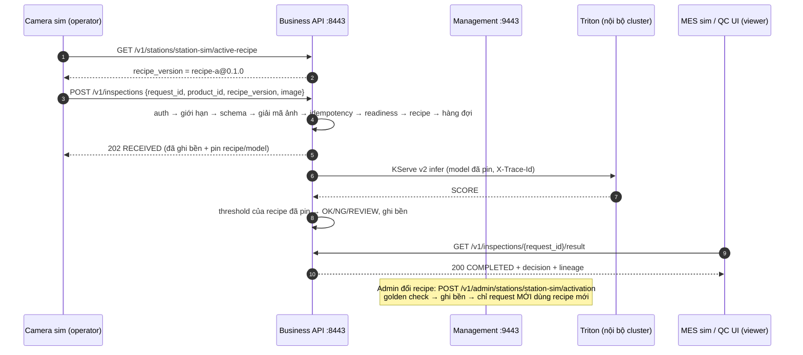

# W2-04 — Hợp đồng Business API (REST) cho tích hợp PCB1

Phiên bản: **1.0.0-draft.1, 06/10/2026**. Trạng thái: **ĐÃ NỘP, CHỜ MENTOR/INTEGRATION REVIEW**. Đây chưa phải tài liệu được chấp nhận.

Liên quan: Câu hỏi đặt ra **#5** (W2-04 thiết kế, W3-03 triển khai). Đầu vào lấy từ W2-01 draft-1 (`../W2-01/`), phản hồi mentor câu 6, 9, 10, và package/recipe W2-05.

| File | Vai trò |
|---|---|
| `openapi.v1.yaml` | **Nguồn chuẩn duy nhất** của hợp đồng (OpenAPI 3.1). Server tham chiếu đọc chính schema trong file này để kiểm request |
| `reference_api.py` | Server tham chiếu (lab) chạy đúng hợp đồng: hai cổng, RBAC, ledger SQLite, worker, adapter KServe v2 |
| `client_example.py` | Client mẫu cho camera/MES/QC UI. Chỉ dùng business API, không import gì từ server |
| `test_contract.py` | 45 contract/negative test. Mọi response được kiểm theo schema của spec |
| `check_openapi.py`, `test_check_openapi.py` | Kiểm tĩnh spec (12 quy tắc) và 9 test chứng minh bộ kiểm bắt được spec sai |
| `examples/` | 26 cặp request/response thật, ghi từ server chạy qua HTTPS (token đã che), kèm `demo-trace.jsonl` |
| `contract-cases.json` | Bảng nối từng yêu cầu mentor và từng tình huống W2-01 với test/kiểm tra làm bằng chứng |
| `verify_w2_04.py` | Một lệnh cho reviewer, xuất `reviewer-result.json` |

---

## 1. Giải thích ngắn

Triton là "đầu bếp": chỉ hiểu tensor, tên model, version nội bộ. Business API là "quầy lễ tân": module khác chỉ gửi **ảnh + mã sản phẩm + mã request**. Quầy lễ tân tự chọn đúng recipe/model, gọi Triton phía sau, lưu kết quả, và trả **OK/NG/REVIEW** kèm thông tin truy vết. Đổi model hay đổi inference server thì camera/MES **không phải sửa gì**.

## 2. Hai plane tách biệt

| | Inference plane | Management plane |
|---|---|---|
| Cổng (đề xuất) | **8443** (HTTPS) | **9443** (HTTPS), nên chỉ mở cho mạng/máy quản trị |
| Route | `/v1/inspections`, `/v1/inspections/{id}`, `/v1/inspections/{id}/result`, `/v1/stations/{id}/active-recipe` | `/v1/admin/packages`, `/v1/admin/packages/validate`, `/v1/admin/recipes`, `/v1/admin/stations/{id}`, `.../activation`, `.../rollback`, `/v1/admin/audit` |
| Ai dùng | Camera/replay (operator), QC UI và MES (viewer) | Kỹ sư vận hành (admin) |
| Chung | `/healthz`, `/readyz`: không token, không dữ liệu nghiệp vụ (cho Kubernetes probe) | |

Quy tắc đã kiểm bằng test: route của plane này **không tồn tại** trên cổng của plane kia (trả 404). Hai listener chạy riêng, nên khi triển khai có thể gắn NetworkPolicy/firewall khác nhau cho từng cổng. Không có route nào chuyển tiếp sang Triton (`/v2/models/...`, `/v2/repository/...`, `/metrics` đều 404 ở cả hai cổng).

## 3. Luồng tích hợp



- Submit trả **202** ngay sau khi request được ghi bền. Kết quả đọc bằng GET (đề xuất ở W2-01). Lý do: khi mất kết nối, kết quả vẫn còn để đọc lại (câu 10 của mentor).
- `GET .../result` khi chưa xong trả `409 RESULT_NOT_READY` kèm `Retry-After: 1`. `client_example.py` tự chờ theo header này.
- Camera không chọn model. Camera chỉ gửi `recipe_version` mình đang dùng; nếu khác recipe đang active thì nhận `409 RECIPE_VERSION_MISMATCH` kèm recipe đang active. Như vậy không bao giờ chấm bằng recipe mà camera không biết.

## 4. Auth và RBAC

**Xác thực (lab):** mỗi principal (thiết bị hoặc người) có một bearer token riêng. Server **chỉ lưu SHA-256** của token (`principals.json`) và so sánh bằng `hmac.compare_digest`. Token không bao giờ xuất hiện trong log, ledger, audit hay response; test quét mọi file dữ liệu sau mỗi test. Hai cổng đều chạy TLS (test và demo dùng CA lab; server tối thiểu TLS 1.2).

**Production (chờ Security/PKI, câu 6):** thay bằng mTLS, chứng chỉ do PKI nhà máy cấp cho từng edge/thiết bị, role lấy từ chứng chỉ. Spec đã khai báo scheme `mutualTLS`. Reference server **chưa** triển khai mTLS.

| Operation | viewer | operator | admin |
|---|:-:|:-:|:-:|
| `submitInspection` (POST /v1/inspections) | 403 | ✅ | 403 |
| `listInspections`, `getInspectionStatus`, `getInspectionResult`, `getActiveRecipe` | ✅ | ✅ | ✅ |
| Mọi `/v1/admin/...` (packages, validate, recipes, station, activation, rollback, audit) | 403 | 403 | ✅ |
| `/healthz`, `/readyz` | không cần token | | |

Ma trận trên được kiểm ở ba nơi: `x-roles` trong spec, route table của server (`check_openapi`), và gọi thật 12 operation × 3 role (`test_rbac_matrix`, kết quả trong `evidence/rbac-matrix-observed.json`). Admin **không** gửi ảnh kiểm tra (least privilege: tách người đổi model với luồng sản xuất). Mọi lần bị 401/403 đều ghi audit, không kèm token.

## 5. Giới hạn và timeout (`info.x-limits`)

| Giới hạn | Giá trị đề xuất | Khi vượt | Trạng thái |
|---|---|---|---|
| Body JSON | 6 MiB (`max_body_bytes`) | `413` theo `Content-Length`, không đọc body | Đề xuất |
| Ảnh sau giải mã base64 | 4 MiB (`max_image_bytes`, W2-01) | `413` | Theo W2-01 |
| Kích thước ảnh | ≤ 4096 × 4096 px | `422 IMAGE_TOO_LARGE_DIMENSIONS` | Đề xuất |
| Định dạng | PNG, JPEG; phải giải mã được và đúng định dạng khai báo | `422 IMAGE_UNDECODABLE`; `400` nếu `content_type` khác | Theo W2-01 |
| Đọc body | 10 s (`body_read_timeout_s`) | `408 REQUEST_TIMEOUT` (chống client gửi chậm) | Đề xuất |
| Hàng đợi admission | 8 request (`queue_capacity`), 1 đang chạy GPU (`max_inflight`) | `429 QUEUE_FULL` + `Retry-After` | Theo lab Item 4 |
| Chờ trong hàng đợi | 5 s (`queue_timeout_s`) | Terminal `TIMEOUT`, reason `QUEUE_TIMEOUT` | Đề xuất |
| Thời gian chạy inference | 10 s (`execution_timeout_s`) | Terminal `TIMEOUT`, reason `EXECUTION_TIMEOUT`; kết quả về muộn chỉ ghi log | **Chờ Operations chốt (W2-01 Q3)** |
| Vùng REVIEW | ±0,05 quanh threshold (`review_band`) | — | **Chờ QC chốt (W2-01 Q1)** |
| Trang danh sách | ≤ 100 | `400` | Đề xuất |

Queue timeout và execution timeout là hai giá trị khác nhau, có test riêng (nguyên tắc 4 của mentor). Không hỗ trợ chunked transfer: thiếu `Content-Length` thì trả 400.

## 6. Idempotency

- `request_id` (do bên gửi tạo, 1–128 ký tự) là khóa idempotency, theo câu 10 của mentor.
- Fingerprint gồm SHA-256 của `product_id`, `product_type`, `recipe_version`, `captured_at`, `station_id`, `retry_of`, `content_type` và SHA-256 của ảnh.
  - Cùng ID, cùng fingerprint → `200` + `Idempotent-Replay: true`, trả record cũ, **không infer lại**. Vẫn trả được khi server đang not-ready.
  - Cùng ID, fingerprint khác → `409 IDEMPOTENCY_CONFLICT`.
  - Sáu request trùng ID gửi song song → đúng 1 record, 1 lần infer (`UNIQUE` trong ledger).
- Bị `429`/`503` thì retry bằng **cùng** `request_id`. Muốn kiểm lại sau FAILED/TIMEOUT/INDETERMINATE thì dùng `request_id` **mới** kèm `retry_of` (phải trỏ tới request lỗi kỹ thuật của cùng `product_id`; sai thì 400). Cách này theo đề xuất W2-01, chờ QC/Integration chốt (Q5).
- Management: kích hoạt lại đúng recipe đang active trả `200 changed=false`. `If-Match: <active_revision>` chống hai admin ghi đè nhau (`412`).

## 7. Error schema

Mọi lỗi dùng `application/problem+json` theo RFC 9457, có thêm các trường riêng:

```json
{
  "type": "urn:vr01:problem:RECIPE_VERSION_MISMATCH",
  "title": "Conflict",
  "status": 409,
  "code": "RECIPE_VERSION_MISMATCH",
  "detail": "requested recipe-a@0.1.0 but station-sim has recipe-b@0.1.0 active",
  "trace_id": "0d3c…",
  "request_id": "st1-20261006-000129",
  "retryable": false,
  "details": {"active_recipe_version": "recipe-b@0.1.0"}
}
```

Client xử lý tự động theo **`code`**, không dựa vào `detail`. `retryable=true` nghĩa là được thử lại với cùng `request_id` sau `Retry-After`.

| HTTP | `code` | Khi nào | Tạo record? | Retry |
|---|---|---|---|---|
| 400 | `INVALID_REQUEST` | JSON/schema/base64/query sai, thiếu `Content-Length`, `retry_of` sai | Không | Không, sửa request |
| 401 | `UNAUTHENTICATED` | Thiếu/sai token | Không | Không |
| 403 | `FORBIDDEN` | Role không được phép | Không | Không |
| 404 | `NOT_FOUND` | ID/station/package không có; route không thuộc plane này | — | Không |
| 405 | `METHOD_NOT_ALLOWED` | Path đúng, method sai | — | Không |
| 408 | `REQUEST_TIMEOUT` | Body gửi quá chậm | Không | Có |
| 409 | `IDEMPOTENCY_CONFLICT` | Cùng ID khác payload | Giữ record cũ | Không |
| 409 | `RECIPE_VERSION_MISMATCH` | `recipe_version` khác recipe active | Không | Không, lấy lại active-recipe |
| 409 | `RESULT_NOT_READY` | GET result khi chưa terminal | — | Có |
| 409 | `TRANSITION_BUSY` / `NO_ROLLBACK_TARGET` | Đang activation khác / không có bản trước | — | Có / Không |
| 412 | `PRECONDITION_FAILED` | `If-Match` lệch | — | Không |
| 413 | `PAYLOAD_TOO_LARGE` | Body hoặc ảnh quá lớn | Không | Không |
| 415 | `UNSUPPORTED_MEDIA_TYPE` | Không phải `application/json` | Không | Không |
| 422 | `IMAGE_UNDECODABLE`, `IMAGE_TOO_LARGE_DIMENSIONS` | Ảnh hỏng/sai định dạng/quá lớn | Không | Không |
| 422 | `RECIPE_NOT_FOUND` | `product_type`/station không có recipe | Không | Không |
| 422 | `PACKAGE_REJECTED`, `ACTIVATION_GOLDEN_FAILED` | Validator W2-05 từ chối / golden lệch; recipe cũ giữ nguyên | — | Không |
| 429 | `QUEUE_FULL` | Hàng đợi đầy | Không | Có, cùng ID |
| 503 | `NOT_READY` | Backend/model chưa sẵn sàng, active recipe chưa xác minh | Không | Có |
| 503 | `STORAGE_UNAVAILABLE` | Ghi ledger lỗi hoặc đĩa còn ít | Không | Có |
| 500 | `INTERNAL_ERROR` | Lỗi không lường trước; chi tiết chỉ trong log theo `trace_id` | — | — |

**Lỗi kỹ thuật không phải HTTP error.** Sau khi request đã được nhận (202), mọi sự cố được ghi thành state terminal: `FAILED` (`BACKEND_ERROR`), `TIMEOUT` (`QUEUE_TIMEOUT`/`EXECUTION_TIMEOUT`) hoặc `INDETERMINATE` (`RESTARTED_DURING_PROCESSING`). Các state này luôn có **`decision = null`**, và spec ép điều đó bằng `if/then` trong schema `InspectionResult`. Lỗi kỹ thuật không bao giờ thành OK/NG (câu 7, 10).

## 8. Đối chiếu W2-01 (F1–F16)

| W2-01 | Hành vi API | Test chứng minh |
|---|---|---|
| N1 | 202 → COMPLETED + OK/NG/REVIEW + lineage | `test_N1_*` (3 test, gồm đủ OK/REVIEW/NG và JPEG) |
| F1 | 400, không tạo record | `test_F1_*` (9 kiểu body sai) |
| F2 | 413 (ảnh > 4 MiB; body > 6 MiB) | `test_F2_payload_too_large` |
| F3 | 422 ảnh không giải mã được, sai định dạng, bị cắt, quá kích thước | `test_F3_*` |
| F4 | 200 replay, không infer lại; song song vẫn chỉ 1 record | `test_F4_*`, `test_concurrent_duplicate_*` |
| F5 | 409 `IDEMPOTENCY_CONFLICT` | `test_F5_*` |
| F6 | 422 `RECIPE_NOT_FOUND` / 409 `RECIPE_VERSION_MISMATCH`, không chấm | `test_F6_*` |
| F7 | 429 + `Retry-After`, retry cùng ID thành công | `test_F7_*` |
| F8 | readyz 503, submit 503, vẫn đọc được kết quả cũ | `test_F8_*`, `test_business_api_translates_*` (Triton mất) |
| F9 | 503 `STORAGE_UNAVAILABLE`; không trả kết quả chưa ghi bền | `test_F9_*` (3 test) |
| F10 | FAILED, `decision=null`, giữ lineage | `test_F10_*` |
| F11 | TIMEOUT; kết quả muộn bị bỏ qua và ghi log | `test_F11_*`, `test_queue_timeout_*` |
| F12 | Sau restart thành INDETERMINATE, không chạy lại | `test_F12_*` |
| F13 | Recipe active được khôi phục sau restart; recipe bị sửa thì 503, **không** tự quay về A | `test_F13_*` (2 test) |
| F14 | Client ngắt kết nối, kết quả vẫn đọc lại được | `test_F14_*` |
| F15 | 404 | `test_F15_*` |
| F16 | Request đang chạy giữ model đã pin; chỉ request mới dùng recipe mới | `test_F16_*` |

Đây là bằng chứng trên **reference server**. Năm GAP mà W2-01 ghi cho controller lab `server-runner-v2` (F3, F6, F9, F11, F13) vẫn còn ở controller đó cho tới khi W3-03 đưa hợp đồng này vào code thật.

## 9. Truy vết end-to-end

Một request được nối qua 5 chỗ bằng `request_id` + `trace_id`. Test `test_trace_end_to_end_request_product_model_config` kiểm cả 5 chỗ khớp nhau:

1. **Response header** `X-Trace-Id`: client tự gửi được, nếu không thì server tạo. Mọi response đều có.
2. **Ledger** (`inspections`): `request_id`, `product_id`, `station_id`, `submitted_by`, `input_sha256`, `trace_id`, và `pin_json` = recipe {name, version, sha256} + model {name, version, manifest_sha256} + threshold + review_band, ghi **một lần lúc admission**.
3. **Result API** `lineage`: đọc từ chính record đó. Digest của recipe/model khớp SHA-256 của file thật trong kho W2-05.
4. **Trace log** (`trace.jsonl`, JSON Lines): `request.admitted` → `inference.started` → `inference.finished` → `request.terminal`, cùng `trace_id`/`request_id`/`product_id`/model/recipe. Thêm `activation.committed` và `audit`.
5. **Backend**: header `X-Trace-Id` và `id = request_id` được gửi sang inference server (KServe v2). `test_business_api_translates_*` kiểm điều này với fake Triton.

Ví dụ thật: `examples/04-mes-get-result-ok.json` và `examples/demo-trace.jsonl`.

## 10. Không phụ thuộc API nội bộ của Triton

- Spec không có path `/v2/...` và không có trường tensor (`inputs`, `outputs`, `datatype`, `shape`, `model_name`). `check_openapi` kiểm điều này và có test chứng minh nó bắt được vi phạm.
- `KServeV2Backend` là adapter duy nhất biết URL inference server, tên tensor (`IMAGE`/`SCORE`) và giao thức KServe v2 (giao thức HTTP của Triton). Đổi Triton sang runtime khác chỉ cần đổi adapter; spec và client giữ nguyên.
- Response nghiệp vụ không lộ URL nội bộ, tên tensor hay `datatype` (có test).
- **Đề xuất triển khai (chưa làm):** Triton chỉ có Service ClusterIP; NetworkPolicy chỉ cho pod business API gọi cổng 8000/8001 của Triton; không có Ingress/NodePort tới Triton.

## 11. Chính sách version

- Path mang major version (`/v1`). Thay đổi breaking (xóa/đổi tên trường, đổi nghĩa mã lỗi, siết validation) → `/v2`, chạy song song `/v1` trong thời gian chuyển đổi.
- Thay đổi không breaking: thêm trường vào response, thêm endpoint, thêm giá trị `code` mới. Client phải bỏ qua trường lạ và xử lý `code` lạ như lỗi không retry.
- Request vẫn **từ chối** trường lạ (`additionalProperties: false`) để bắt lỗi tích hợp sớm.
- `info.version` theo semver. Bản hiện tại `1.0.0-draft.1`.

## 12. Cách kiểm (reviewer)

```bash
python3 -m pip install -r requirements.txt
python3 -I verify_w2_04.py --output reviewer-result.json --evidence-dir evidence
```

Lệnh này chạy kiểm tĩnh spec, 9 test của bộ kiểm, 45 contract test, rồi chạy lại demo HTTPS (server chạy như tiến trình riêng) và kiểm lại example vừa sinh theo spec. Kết quả được nối với 12 yêu cầu mentor và 17 tình huống W2-01. Thời gian khoảng 15–20 s, không cần GPU, mạng hay Docker. Chạy server bằng tay:

```bash
python3 reference_api.py --init-lab-principals ./lab-auth
python3 reference_api.py --principals ./lab-auth/principals.json --data-dir ./run-data
```

`lab-auth/lab-tokens.secret.json` (mode 600) chứa token. Không đưa file này vào evidence hay repo.

## 13. Giới hạn — điều bộ này KHÔNG chứng minh

- **Reference server là lab**, không phải service production. Backend mặc định là stub tuyến tính trên package fixture W2-05 (ảnh → xám 2×2 → `gain·mean + bias`). Adapter KServe v2 chỉ được test với **fake** Triton, chưa chạy với Triton/GPU thật.
- **Chưa đưa vào gateway/controller đang chạy** trên Kubernetes (GPU A, Item 11). Gateway lab đó vẫn dùng route cũ không version (`/infer`, `/requests/{id}`, `/activate`, `/status`) trên một cổng. Việc này thuộc **W3-03**.
- Auth là bearer token lab, chưa mTLS/PKI. Chưa có rate limit theo từng client, chưa có cấp/thu hồi/xoay vòng token qua API.
- SQLite thay PostgreSQL (ADR W2-02 còn mở). Một worker (`max_inflight=1`). Chưa lưu ảnh gốc hay retention (W2-02).
- Quyết định OK/NG/REVIEW dùng threshold fixture + `review_band` đề xuất, **không** phải tiêu chí QC. Execution timeout 10 s là đề xuất.
- Mọi PASS là contract/integration trong lab trên một máy macOS. Đây **không** phải nghiệm thu mentor, QC hay production.

## 14. Câu hỏi cần chốt

| # | Câu hỏi | Đầu mối |
|---|---|---|
| A1 | Cổng 8443/9443 và việc management chỉ mở cho mạng quản trị có phù hợp mạng nhà máy không | IT/OT |
| A2 | Async 202 + GET (đề xuất) hay MES cần push/callback | Integration |
| A3 | Định dạng `request_id`/`product_id` thật; MES có giữ `request_id` không | Integration |
| A4 | Lộ trình bearer token → mTLS, ai cấp/thu hồi chứng chỉ thiết bị | Security/PKI |
| A5 | `review_band` và execution timeout (W2-01 Q1, Q3) | QC, Operations |
| A6 | Mã lỗi khi sai recipe: đang dùng 409 cho sai version, 422 cho không có recipe (W2-01 Q6) | Mentor |
