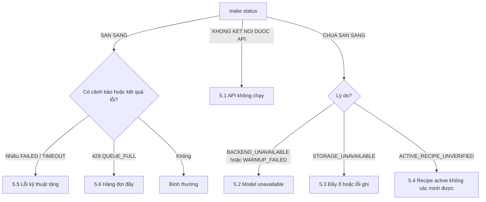

# VR-01 MVP — Runbook vận hành (W4-05)

Bản: **draft-2, 11/10/2026** (sửa theo góp ý của lượt diễn tập độc lập), cho bản triển khai **Docker Compose** (lab). Bản Kubernetes dùng cùng các lệnh `vr01ctl`, chỉ khác phần cài và khởi động (xem `deploy/k8s/README.md`).

Người dùng tài liệu này: kỹ sư vận hành có quyền `root` trên máy trạm và có file token admin trong `run/auth/`. Mọi lệnh chạy trong thư mục `mvp/`. Operator tại màn hình cảm ứng không cần tài liệu này.

Ký hiệu trạng thái diễn tập ở cuối mỗi quy trình:

- **[ĐÃ CHẠY]** quy trình đã được chạy thật trên Triton thật (VPS, 11/10/2026); bằng chứng trong `evidence/`.
- **[LAPTOP]** mới chạy trên laptop với inference server giả.
- **[CHƯA DIỄN TẬP]** viết theo thiết kế, chưa ai chạy thử.

Ngày 11/10/2026 một agent AI độc lập (không phải người), chỉ đọc README và runbook này, đã làm trọn 8 việc trên một VPS mới mà không cần can thiệp: cài, kiểm sức khỏe, đổi model, rollback, sao lưu, khôi phục, dừng/bật, gói chẩn đoán (`evidence/person-b-2026-10-11-runbook/`). Các điểm nó góp ý đã được sửa trong bản này. Chưa có **người** vận hành nào tự làm.

---

## 0. Tra nhanh

| Tôi muốn | Lệnh |
|---|---|
| Biết hệ thống có sẵn sàng không, model nào đang chạy | `make status` |
| Bật / dừng | `make start` / `make stop` |
| Kiểm nhanh toàn luồng | `make smoke` |
| Đổi model | `python3 tools/vr01ctl.py activate <recipe> --reason "..."` |
| Quay về model trước | `python3 tools/vr01ctl.py rollback --reason "..."` |
| Xem sản phẩm chưa có kết luận | `python3 tools/vr01ctl.py pending` |
| Tra một request | `make trace ID=<request_id>` |
| Sao lưu / khôi phục | `make backup` / `make restore BACKUP=run/backup/<tên>` |
| Gói chẩn đoán gửi hỗ trợ | `make diag` |
| Xem log container | `make logs` |
| Dashboard và cảnh báo | `make obs-start`, rồi mở `http://127.0.0.1:3000` |

Nguyên tắc cần nhớ:

1. **Hệ thống tự phục hồi không có nghĩa là dây chuyền được chạy tiếp.** Sản phẩm đi qua lúc hệ thống chưa sẵn sàng, hoặc có kết quả `FAILED` / `TIMEOUT` / `INDETERMINATE` / `CANCELLED`, là **chưa được kiểm**. Xử lý chúng theo quy trình QC.
2. Không sửa tay file trong `run/data/`, không xóa `run/`.
3. Token và private key trong `run/auth/`, `run/tls/` không được chép ra ngoài, không dán vào ticket hay chat.

## 1. Cài đặt, bật, dừng, kiểm tra sức khỏe

### 1.1 Cài lần đầu và bật **[ĐÃ CHẠY]**

Làm theo mục Quick start của `README.md` (cài Docker, lấy mã nguồn, `make start`). Thành công khi lệnh thoát mã 0 và hai dòng cuối là `Container vr01-mvp-triton-1  Healthy`, `Container vr01-mvp-api-1  Healthy`.

Bản hiện tại cần Internet để cài (tải gói và image). Cài offline chưa có cho bản này.

### 1.2 Kiểm tra sức khỏe **[ĐÃ CHẠY]**

```bash
make status
```

Mong đợi: dòng đầu `SAN SANG`, kèm recipe và model đang active. Nếu `CHUA SAN SANG: <lý do>`, xem mục 5.

Kiểm toàn luồng (gửi ảnh mẫu, đổi model, kiểm quyền). Lưu ý lệnh này **để lại recipe-b đang active**; chỉ chạy khi không có sản xuất. Sau đó đặt lại recipe cần dùng bằng lệnh ở mục 2.1 (trên máy mới cài, recipe mặc định là `recipe-a`):

```bash
make smoke
```

Mong đợi dòng cuối: `SMOKE PASS  18/18`.

### 1.3 Dừng và bật lại **[ĐÃ CHẠY]**

```bash
make stop
```

```bash
make start
```

Dữ liệu trong `run/` được giữ. Sau khi bật lại, model đang active là model trước khi dừng (kiểm bằng `make status`). Request đang dở lúc dừng sẽ có trạng thái `INDETERMINATE`.

Sau khi máy mất điện hoặc reboot, stack tự bật lại, không cần đăng nhập (đã chạy thử reboot ngày 11/10). Vẫn chạy `make status` để xác nhận.

## 2. Đổi model và rollback

### 2.1 Đổi sang recipe/model khác **[ĐÃ CHẠY]**

Xem có gì:

```bash
python3 tools/vr01ctl.py recipes
```

Đổi: tham số là **tên recipe** như cột đầu của lệnh `recipes`, không kèm `@version`. Bắt buộc ghi lý do; lý do được lưu vào audit:

```bash
python3 tools/vr01ctl.py activate recipe-b --reason "lo san xuat 2026-10-12 dung model B"
```

Mong đợi: `DA CHUYEN: recipe-a@0.1.0 -> recipe-b@0.1.0` và dòng `golden: ... DAT   activation_id N` (N là số thứ tự lần chuyển, dùng để đối chiếu với lịch sử).

Điều hệ thống tự làm: nạp model mới, chạy mẫu chuẩn (golden), chỉ chuyển khi đạt; request đang chạy vẫn dùng model cũ; model cũ được gỡ sau khi các request đó xong. Camera phải gửi `recipe_version` mới, nếu không sẽ nhận `409 RECIPE_VERSION_MISMATCH` kèm tên recipe đang active.

| Kết quả | Nghĩa | Làm gì |
|---|---|---|
| `HTTP 422 ACTIVATION_GOLDEN_FAILED` | Model mới không qua mẫu chuẩn. **Model cũ vẫn đang dùng**, không sản phẩm nào bị chấm bằng model mới | Không thử lại. Báo người cung cấp model |
| `HTTP 422 RECIPE_NOT_FOUND` / `PACKAGE_REJECTED` | Sai tên, hoặc package không hợp lệ (checksum, I/O) | Kiểm tên; package sai thì không dùng |
| `HTTP 409 TRANSITION_BUSY` | Đang có một lần chuyển khác | Chờ vài giây, chạy lại |
| `HTTP 503` | Hệ thống chưa sẵn sàng | Xem mục 5 trước |

### 2.2 Rollback về recipe trước **[ĐÃ CHẠY]**

```bash
python3 tools/vr01ctl.py rollback --reason "model B cho ket qua bat thuong"
```

Mong đợi: `DA CHUYEN: recipe-b@0.1.0 -> recipe-a@0.1.0`. Các kết quả đã có không bị thay đổi. Xem lại lịch sử:

```bash
python3 tools/vr01ctl.py history
```

### 2.3 Tự rollback **[ĐÃ CHẠY]**

Trong 60 giây sau khi chuyển, nếu model mới lỗi 3 lần liên tiếp, hệ thống tự quay về recipe trước và bật cảnh báo `VR01AutoRollback`. Khi thấy cảnh báo này:

1. `python3 tools/vr01ctl.py pending` để lấy danh sách sản phẩm bị lỗi; chúng cần được kiểm lại.
2. Không kích hoạt lại recipe đó trước khi tìm ra nguyên nhân.

## 3. Sao lưu và khôi phục

### 3.1 Sao lưu **[ĐÃ CHẠY]**

Chạy được khi hệ thống đang hoạt động:

```bash
make backup
```

Mong đợi một dòng JSON có `"integrity_check": "ok"` và `"has_trace": true`. Giá trị `"backup"` trong dòng đó là đường dẫn bản sao lưu, dùng cho lệnh khôi phục. Bản sao lưu nằm ở `run/backup/backup-<giờ UTC>/`, gồm ledger, log trace, ảnh và bảng hash.

**Bản sao lưu nằm trên cùng ổ với dữ liệu.** Nó không bảo vệ khi hỏng ổ. Phải chép thư mục đó sang nơi khác theo quy định của nhà máy (nơi lưu chưa được IT chốt). Chưa có lịch sao lưu tự động.

### 3.2 Khôi phục **[ĐÃ CHẠY]**

Lệnh này dừng hệ thống, kiểm bảng hash của bản sao lưu, đổi tên dữ liệu hiện tại thành `run/data.before-restore-<giờ>` (không xóa), chép bản sao lưu vào, rồi bật lại:

```bash
make restore BACKUP=run/backup/<tên bản sao lưu>
```

Ví dụ: `make restore BACKUP=run/backup/backup-20261011T045148Z`. Thay bằng tên bản sao lưu của bạn.

Sau đó kiểm:

```bash
make status
```

Mọi request nhận **sau** thời điểm sao lưu sẽ không còn trong hệ thống. Khi diễn tập, muốn thấy rõ điều này thì gửi một request sau khi sao lưu (ví dụ `make smoke`), ghi lại `request_id`, khôi phục, rồi `make trace ID=<request_id>`: lệnh phải báo không tìm thấy. Nếu lệnh báo `backup does not match its MANIFEST, refusing to restore`, bản sao lưu đã bị hỏng hoặc bị sửa: không dùng, lấy bản khác.

Số đo lab ngày 11/10: khôi phục 1.124 dòng và 256 ảnh mất khoảng 24 giây trên VPS 2 vCPU. Đây không phải cam kết thời gian cho máy đích.

## 4. Nâng cấp và quay lại phiên bản phần mềm **[ĐÃ CHẠY bằng cách đổi tag image; chưa chạy bằng `git checkout`]**

1. `make backup`, chép bản sao lưu ra ngoài máy.
2. Ghi lại phiên bản đang chạy: `git rev-parse HEAD` và `make digests`.
3. Lấy mã nguồn bản mới (`git fetch && git checkout <tag>`), rồi `make start`. Lệnh này build lại image API và khởi động lại container.
4. `make status`, sau đó `make smoke` nếu không có sản xuất.
5. Quay lại bản cũ: `git checkout <tag cũ>`, `make start`, `make status`. Nếu bản mới đã ghi dữ liệu mà bản cũ không đọc được, dùng `make restore` với bản sao lưu ở bước 1.

Hệ thống ngừng nhận ảnh trong lúc khởi động lại container. Lượt 11/10 (đổi tag image khi đang có tải 10 request/giây): mỗi chiều khoảng 9 giây kể cả build; client gặp lỗi kết nối, gửi lại cùng `request_id` và không request nào mất hay sai. Đó là số của VPS thử, không phải cam kết.

## 5. Xử lý sự cố



Trong mọi trường hợp dưới đây: sản phẩm đi qua trong lúc sự cố là chưa được kiểm; lấy danh sách bằng `python3 tools/vr01ctl.py pending`.

### 5.1 API không chạy (`VR01ApiDown`) **[ĐÃ CHẠY phần tự phục hồi]**

1. `docker ps -a --filter name=vr01-mvp` để xem trạng thái container.
2. `make logs` để xem lỗi cuối.
3. `make start`.
4. Nếu container khởi động lại liên tục (`VR01RestartLoop`): `make diag`, gửi gói chẩn đoán, **không** xóa `run/`.

Khi tiến trình API chết, Docker tự khởi động lại (đã thử `kill -9`: sẵn sàng lại sau khoảng 1,5 giây, model active giữ nguyên, request dở thành `INDETERMINATE`).

### 5.2 Model unavailable (`VR01ModelUnavailable`) **[ĐÃ CHẠY]**

Hệ thống ngừng nhận ảnh (503) và tự thử nạp lại đúng model đang active mỗi 2 giây. Nó không tự chuyển sang model khác.

1. `docker ps --filter name=vr01-mvp-triton` để xem Triton có chạy không. Không chạy thì `make start`.
2. Triton chạy mà vẫn chưa sẵn sàng sau 2 phút: `docker logs --tail 50 vr01-mvp-triton-1`. Nếu log báo không tìm thấy model, chạy `make start` (lệnh này tạo lại model repository).
3. Vẫn không được: `make diag`, và cân nhắc `vr01ctl rollback` nếu chỉ model hiện tại lỗi.

Đã thử dừng Triton 24 giây khi đang có tải: không có kết quả sai, request trong lúc đó bị từ chối sạch (không tạo bản ghi), bật lại Triton thì hệ thống tự hồi phục.

### 5.3 Đầy ổ hoặc lỗi ghi (`VR01StorageLow`, `VR01StorageErrors`) **[ĐÃ CHẠY phần hành vi của hệ thống; các bước dọn chưa diễn tập]**

Khi ổ còn dưới 64 MiB hoặc ghi ledger lỗi, hệ thống ngừng nhận ảnh. Nó không trả kết quả nào chưa ghi được xuống ổ.

1. `df -h .` để xác nhận.
2. Giải phóng chỗ theo thứ tự an toàn: bản sao lưu cũ đã chép ra ngoài (`run/backup/`), thư mục `run/data.before-restore-*` và `run/data.lost-*` cũ, image Docker không dùng (`docker image prune`). **Không** xóa `run/data/`.
3. `make stop` rồi `make start` để hệ thống kiểm lại ổ, sau đó `make status`.

Việc dọn ảnh theo retention chưa được tự động hóa; retention chưa được QC chốt.

### 5.4 Recipe active không xác minh được **[có unit test, CHƯA DIỄN TẬP]**

Lúc khởi động, file recipe hoặc package của recipe đang active có digest khác với lúc được kích hoạt (file bị sửa hoặc hỏng). Hệ thống cố ý không tự quay về recipe khác.

1. `python3 tools/vr01ctl.py audit` để xem dòng `restore_active_recipe ... UNVERIFIED`.
2. Xác định recipe đúng cần dùng, rồi kích hoạt lại bằng `vr01ctl activate`. Việc này là xác nhận của admin và được ghi audit.
3. Báo sự việc: file trong kho model đã bị thay đổi ngoài quy trình.

### 5.5 Lỗi kỹ thuật tăng (`VR01TechnicalFailureRatioHigh`) **[CHƯA DIỄN TẬP]**

1. `python3 tools/vr01ctl.py pending` để xem lý do: `BACKEND_ERROR` (inference server lỗi), `EXECUTION_TIMEOUT` (chạy quá 10 giây), `QUEUE_TIMEOUT` (chờ quá 5 giây).
2. `make trace ID=<một request lỗi>` để xem thời gian từng pha.
3. `BACKEND_ERROR` ngay sau khi đổi model: rollback (mục 2.2). Timeout: xem panel độ trễ và hàng đợi trên dashboard.

### 5.6 Hàng đợi đầy (`VR01QueueSaturated`) **[có test, CHƯA DIỄN TẬP]**

Hệ thống nhận tối đa 8 request cùng lúc; vượt quá thì trả 429 và bên gửi phải gửi lại cùng `request_id`. Kiểm thời gian suy luận trên dashboard; nếu model chậm bất thường thì xử lý như 5.5.

### 5.7 GPU hết bộ nhớ (OOM) **[CHƯA ÁP DỤNG cho bản này]**

Bản MVP mới chạy CPU. Hành vi OOM trên GPU đã được thử ở bản lab trước (Item 4) với controller cũ, chưa thử với MVP. Việc này thuộc phiên GPU của Tuần 4.

## 6. Gói chẩn đoán **[ĐÃ CHẠY]**

```bash
make diag
```

Tạo `run/diag/vr01-diag-<giờ UTC>.tar.gz`. Trong gói: `summary.json` (trạng thái, số đếm ledger, 20 lỗi kỹ thuật gần nhất, audit gần nhất), `trace-tail.jsonl`, `metrics.txt`, `host.txt`, `docker.txt` và log của hai container. Tức là gồm trạng thái, số đếm ledger, 20 lỗi kỹ thuật gần nhất, audit gần nhất, 2.000 dòng log cuối, metrics hiện tại, thông tin máy và log container. Gói **không** chứa token, private key hay ảnh (đã kiểm bằng cách tìm token trong gói). Vẫn nên xem lại trước khi gửi ra ngoài nhà máy, vì gói có mã sản phẩm và mã request.

## 7. Giới hạn đã biết

- Bản Compose, một máy, một worker. Hỏng máy hoặc hỏng ổ là dừng trạm.
- Cần Internet để cài; chưa có gói offline cho bản này.
- Model mẫu là hàm tuyến tính, không phải model QC; chưa chạy GPU.
- Token lab và chứng chỉ TLS tự ký 30 ngày; chưa có quy trình cấp và thu hồi; chưa PKI nhà máy. Chứng chỉ hết hạn thì client không kết nối được: xóa `run/tls/` rồi `make start` để tạo lại (chỉ dùng cho lab).
- Hủy request không giải phóng GPU.
- Sao lưu thủ công, trên cùng ổ.
- Cảnh báo chỉ hiện trên Prometheus/Grafana, chưa gửi đi đâu; ngưỡng chưa được Operations duyệt.
- Các quy trình đánh dấu [CHƯA DIỄN TẬP] ở trên.
