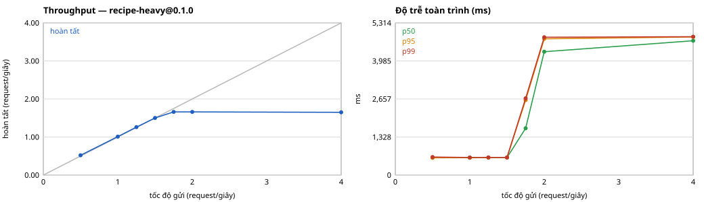

# W4-04 — Báo cáo hiệu năng, stress, soak và fault test

Trạng thái 11/10/2026: **bản nháp, phần soak và ba bài sau soak chưa có kết quả.** Mọi con số lấy từ file gốc trong `evidence/`; mỗi mục ghi file nguồn.

## 1. Đọc trước: báo cáo này nói được gì và không nói được gì

| | |
|---|---|
| Máy GPU | VPS thuê, NVIDIA RTX A6000 48 GB, 6 vCPU, 32 GB RAM, Ubuntu 24.04 |
| Máy CPU | VPS thuê, 4 vCPU, 7,7 GB RAM, Ubuntu 26.04 |
| Inference server | Triton 2.60.0 (image 25.08-py3, pin digest), 1 instance mỗi model |
| API | 1 worker, hàng đợi có giới hạn, ledger SQLite |
| Model | Fixture tự sinh: mạng tích chập Conv3×3 + ReLU, trọng số tất định. **Không phải model QC.** |

- Các số cho biết **hệ thống cư xử ra sao** khi bão hòa, khi chuyển model, khi có sự cố. Chúng **không** phải hiệu năng của model QC thật, và không phải năng lực của máy đích.
- GPU là NVIDIA trên cloud. Chưa chạy trên máy AMD của nhà máy; không suy kết quả này sang AMD.
- Mỗi bài chạy một lượt. Chưa có độ lặp lại.
- Chưa quét theo batch và concurrency phía server: API hiện gửi từng request (batch 1) qua 1 worker, nên chỉ có trục "tốc độ gửi".

## 2. Chứng minh chạy trên GPU, không rơi về CPU

Nguồn: `evidence/vps-gpu-2026-10-11T0905Z/compose/session-gpu-report.json`, bước G1.

- `nvidia-smi --query-compute-apps` có `tritonserver, 932 MiB`.
- `config.pbtxt` của model ghi `KIND_GPU`; với `KIND_GPU` mà không có GPU thì Triton từ chối nạp model, nên nạp được đã là bằng chứng.
- Metric của Triton: `nv_gpu_memory_used_bytes` > 0 và `nv_inference_request_success` có nhãn `gpu_uuid`.
- Cùng model mức `cpu` trên máy CPU mất khoảng 104 ms; mức `gpu` (nặng hơn khoảng 85 lần về số phép tính) trên GPU mất 89 ms.

## 3. Quét tải tới bão hòa

Nguồn: `evidence/vps-gpu-2026-10-11T0905Z/compose/load-sweep-gpu-heavy-report.json`. Model nặng mức `gpu-xl` (ảnh 1024², 64 lớp, 128 kênh), mỗi bước 40 giây.



| Tốc độ gửi (req/s) | Hoàn tất (req/s) | p50 (ms) | p95 (ms) | p99 (ms) | Chờ hàng đợi p95 (ms) | Bị từ chối |
|---|---|---|---|---|---|---|
| 0,5 | 0,52 | 603 | 605 | 630 | 14 | 0 |
| 1,0 | 1,01 | 605 | 609 | 613 | 14 | 0 |
| 1,25 | 1,26 | 609 | 613 | 616 | 18 | 0 |
| 1,5 | 1,50 | 612 | 616 | 616 | 19 | 0 |
| 1,75 | 1,66 | 1.635 | 2.617 | 2.680 | 2.015 | 0 |
| 2,0 | 1,66 | 4.309 | 4.759 | 4.814 | 4.155 | 7 × 429 |
| 4,0 | 1,65 | 4.690 | 4.822 | 4.831 | 4.220 | 87 × 429 |

- **Điểm bão hòa:** khoảng 1,66 request mỗi giây. Đó đúng là 1 chia cho thời gian một lần suy luận (0,59 giây): nút cổ chai là **một instance model chạy tuần tự**, không phải API hay ledger.
- **Dưới điểm bão hòa** độ trễ gần như không đổi (p95 605–616 ms), thời gian chờ hàng đợi dưới 20 ms.
- **Quá điểm bão hòa** hàng đợi dài ra tới giới hạn, độ trễ dừng ở khoảng 4,8 giây (không tăng vô hạn), phần vượt bị từ chối bằng `429 QUEUE_FULL`. Không có request nào bị mất, treo hay trả sai.
- Không có `FAILED` hay `TIMEOUT` trong cả lượt quét.

Trên máy CPU (`evidence/vps-w4-2026-10-11T0754Z/`): model tuyến tính bão hòa quanh 100 req/s, model nặng mức `cpu` quanh 8 req/s; quá tải cũng trả 429.

## 4. Chuyển model khi đang có tải liên tục

| Máy | Tải | Số request | Lần chuyển | Sai model | Trùng | p95 (ms) | Nguồn |
|---|---|---|---|---|---|---|---|
| GPU, hai model nặng | 0,85 req/s, 5 phút, chuyển mỗi 30 s | 256 | 9/9 | 0 | 0 | 689 | `session-gpu-cutover.json` |
| GPU, hai model nhẹ, có kill Triton | 501 request | 501 | 6/6 | 0 | 0 | — | bước P8 |
| CPU, hai model nhẹ | 601 request | 601 | 11/11 | 0 | 0 | — | `vps-2026-10-11T0436Z` |

"Sai model" nghĩa là kết quả ghi model khác với model đã ghim cho request đó lúc nhận. Mỗi request được đối chiếu ảnh, recipe, model và điểm.

## 5. Sự cố chủ động gây ra

| Sự cố | Máy | Hành vi quan sát được | Thời gian phục hồi |
|---|---|---|---|
| Hết VRAM lúc nạp model (G4) | GPU | Kích hoạt bị từ chối 422, recipe cũ vẫn phục vụ, `readyz` 200, không cần restart. Log Triton có lỗi cấp phát bộ nhớ thật | Không gián đoạn |
| Hết VRAM khi nạp model thứ hai cạnh model đang chạy (G5) | GPU | Bị từ chối 422, model đang chạy không bị ảnh hưởng | Không gián đoạn |
| Hết VRAM giữa lúc đang suy luận (G6) | GPU | **Chưa chạy** (đã viết bài thử) | — |
| Model mới lỗi 3 lần liên tiếp sau khi chuyển (P14) | GPU, CPU | Tự rollback về recipe cũ; 3 request lỗi là `FAILED`, không có kết luận OK/NG | Ngay sau lỗi thứ ba |
| kill -9 API khi 1 request đang chạy, 2 đang chờ (P7) | GPU, CPU | Cả 3 thành `INDETERMINATE`, không tự chạy lại; gửi lại bằng mã mới thì xong | Sẵn sàng lại sau 1 giây |
| kill -9 Triton khi có tải (P8) | GPU, CPU | 501/501 request có kết quả đúng, 0 trùng; API tự nạp lại model | Trong vòng 41 giây tính tới hết lượt tải |
| Dừng Triton 24 giây khi có tải | CPU | Request trong lúc đó bị chặn ở bên gửi rồi gửi lại, không mất | Theo thời gian Triton dừng |
| Nâng cấp và quay lại image API khi có tải (P16) | CPU | 901 request, 0 sai, 0 trùng; client gặp 49 lỗi kết nối và gửi lại cùng mã | Khoảng 8,7 giây mỗi chiều |
| Cắt mạng 10 giây (P17) | CPU | 401 request, 0 mất, 0 trùng | Hết cắt là chạy tiếp |
| Ổ lưu ảnh đầy thật (P15) | CPU | `503 STORAGE_UNAVAILABLE`, `readyz` 503, request bị từ chối không để lại bản ghi dở | Có chỗ lại là phục vụ tiếp |

Thời gian phục hồi ở trên là quan sát trong một lượt trên máy thử, **không phải RTO** cam kết.

## 6. Soak 8 giờ

Cấu hình: 28.800 giây, 0,678 request mỗi giây (GPU bận khoảng 40%), chuyển qua lại hai model nặng mỗi 300 giây, **không restart định kỳ**, lấy mẫu mỗi 30 giây.

Kết quả: **chưa có** (đang chạy). Khi xong, mục này sẽ có: số request và số sai/trùng, số lần chuyển, p50/p95/p99, bảng xu hướng bộ nhớ (RAM API, RAM Triton, VRAM) so giờ đầu với giờ cuối, số lần container restart, và biểu đồ `soak-charts.svg`.

## 7. Kết luận tạm thời

1. Nút cổ chai ở tải cao là instance model đơn chạy tuần tự. Muốn throughput cao hơn phải thêm instance hoặc batch phía Triton; cả hai chưa thử.
2. Khi quá tải hoặc gặp sự cố, hệ thống chọn **từ chối rõ ràng** (429, 503, 422) hoặc ghi trạng thái kỹ thuật (`FAILED`, `TIMEOUT`, `INDETERMINATE`) thay vì trả kết quả có thể sai. Trong mọi bài, không có request nào nhận kết quả của model hay sản phẩm khác.
3. Hai kiểu hết VRAM đã thử đều không làm hỏng model đang phục vụ.

## 8. Chưa làm

- Soak (đang chạy); hết VRAM giữa lúc suy luận; quét theo batch và số instance.
- Model QC thật; máy AMD; mất điện thật; soak 24 giờ.
- Lặp lại mỗi bài nhiều lượt để có khoảng dao động.

## 9. Chạy lại

```
make start SLOW=1 HEAVY=gpu                       # máy GPU: VR01_GPU=1 và TRITON_INSTANCE_KIND=KIND_GPU trong deploy/.env
python3 -B tests/real_session.py --phase gpu      # G1–G5, P7, P8, P13, P14
python3 -B tests/load_sweep.py --run-dir run --recipe recipe-heavy --rates 0.5,1,1.25,1.5,1.75,2,4 --step-seconds 40 --output run/load-sweep-gpu-heavy-report.json
python3 -B tests/sweep_chart.py run/load-sweep-gpu-heavy-report.json
python3 -B tests/soak_report.py --run-dir run && python3 -B tests/soak_chart.py --run-dir run
```
